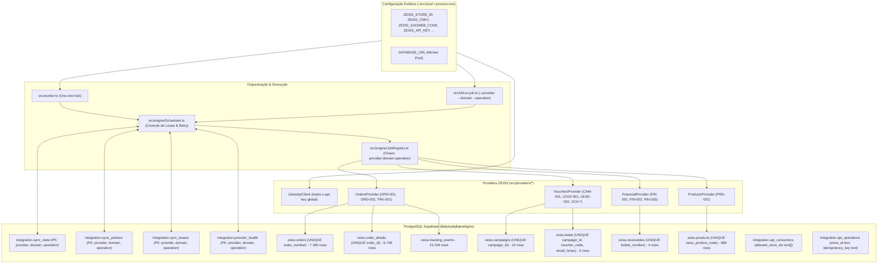
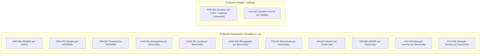
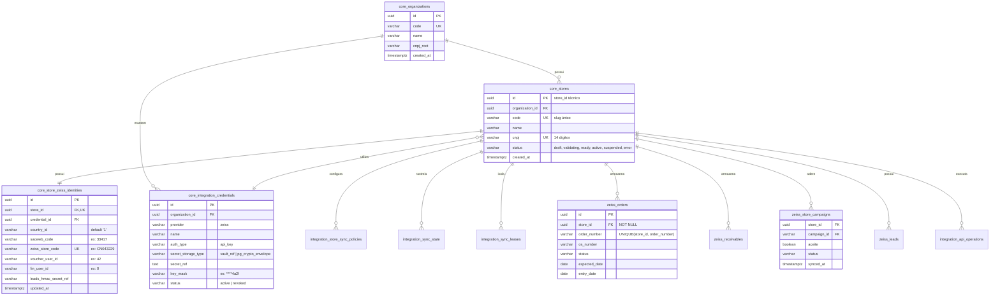
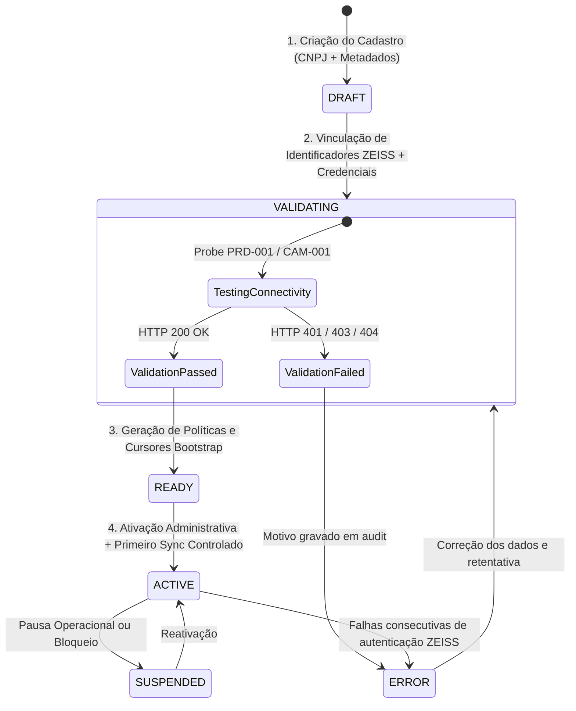
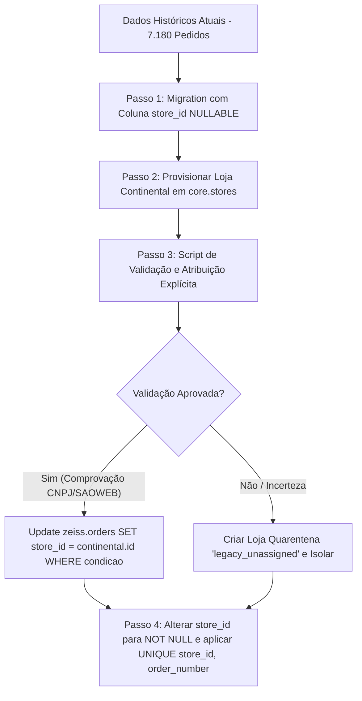

# BD_API_ZEISS — Relatório Consolidado ML-001
## Auditoria Técnica e Arquitetura-Alvo Multi-Loja

**Data da Auditoria:** 19 de Outubro de 2026  
**Status:** DRAFT / PROPOSTA TÉCNICA (Fase ML-001 — Leitura e Planejamento)  
**Projeto:** `C:\Antigravity\BD_API_ZEISS`  
**Supabase Canônico:** `BD_API_ZEISS` (ref: `bklpztydqllqevekgins`)  
**Autor:** Antigravity Architect Agent  

---

## SUMÁRIO EXECUTIVO

O presente relatório consolida a auditoria completa de código, banco de dados PostgreSQL (Supabase), contratos de API da ZEISS, engine de sincronização e camada de consumo do projeto **BD_API_ZEISS**. 

O objetivo principal desta fase (**ML-001**) é definir a estratégia arquitetural e o modelo de dados para evoluir o sistema de uma operação mono-loja acoplada a variáveis de ambiente estáticas para uma **plataforma multi-loja robusta, isolada, autônoma e escalável**. Sob a arquitetura-alvo, novas unidades operacionais (a começar pela loja **Continental**) poderão ser cadastradas, validadas, autorizadas e sincronizadas dinamicamente, **sem duplicar código e sem a necessidade de novos deploys**.

A auditoria confirmou que a plataforma possui um núcleo operacional maduro e contratos estritos, porém opera sob suposições de tenant único que geram **riscos críticos de colisão de dados, sobrescrita mútua e bloqueios de sincronização** caso mais de uma loja seja conectada sob o schema atual.

---

## SEÇÃO 1: ARQUITETURA ATUAL COMPROVADA

### 1.1 Topologia e Componentes Atuais

A arquitetura comprovada em código e banco de dados organiza-se nos seguintes blocos:



### 1.2 Auditoria de Código: Como o Runtime Opera Hoje

| Componente | Localização | Comportamento Comprovado | Acoplamento Identificado |
|---|---|---|---|
| **Configuração** | `src/config/config.ts` | Lê `process.env.ZEISS_*` através de getters diretos (`cnpj`, `countryId`, `storeId`, `saowebCode`, `apiKey`, `voucherUserId`, `finUserId`, `leadsHmacSecret`). | **Totalmente mono-tenant**. Não suporta múltiplos valores em tempo de execução. |
| **Cliente HTTP** | `src/config/client.ts` | Injeta fixo `'x-api-key': zeissConfig.apiKey` em todas as chamadas. | **Chave única global**. Impede o uso de credenciais distintas por loja. |
| **Orders Provider** | `src/providers/orders.ts` | Concatena `zeissConfig.cnpj` e `zeissConfig.countryId` em ORD-001; envia `zeissConfig.saowebCode` em ORD-002 e TRK-001. | Parâmetros fixos lidos do ambiente. |
| **Vouchers Provider** | `src/providers/vouchers.ts` | Concatena `zeissConfig.storeId` em CAM-001, LEAD-001, LEAD-002; injeta `zeissConfig.voucherUserId` em VCH-003. | Identificadores de loja fixos. |
| **Financial Provider** | `src/providers/financial.ts` | Concatena `zeissConfig.storeId` e `zeissConfig.countryId` em FIN-001; injeta `zeissConfig.finUserId` em FIN-002. | Identificadores de loja fixos. |
| **Products Provider** | `src/providers/products.ts` | Concatena `zeissConfig.countryId` e `zeissConfig.cnpj` em PRD-001. | Chamada restrita a um único CNPJ. |
| **Composition Root** | `src/engine/CompositionRoot.ts` | Instancia providers e repositórios sem passar contexto de loja. | Singleton de repositórios e jobs. |
| **Scheduler** | `src/engine/Scheduler.ts` | Orquestra jobs com chave `(provider, domain, operation)`. | Sem segregação de leases ou políticas por loja. |
| **Job Registry** | `src/engine/JobRegistry.ts` | Chave de lookup é `${provider}:${domain}:${operation}`. | Não permite jobs parametrizados por unidade. |
| **Worker Entrypoint** | `src/worker.ts` | Carrega `.env.local` e dispara `scheduler.tick()`. | Execução cega sem seleção de loja. |
| **CLI Administrativo** | `src/cli/run-job.ts` | Aceita apenas `--provider`, `--domain`, `--operation`. | Não aceita flag `--store` ou `--store-id`. |

### 1.3 Auditoria de Banco de Dados Remoto (Supabase `bklpztydqllqevekgins`)

A inspeção direta nas tabelas e constraints revelou:

1. **`zeiss.orders` (7.180 linhas)**:
   - Primary Key: `id` (UUID).
   - Constraint: `UNIQUE (order_number)`.
   - Colunas: `id`, `order_number`, `os_number`, `status`, `expected_date`, `entry_date`, `codneg`, `nomeneg`, `garantia`, `pedorigar`, `antec`, `motivo`, `pedoribon`, `pedconsbon`, `montagem`, `aguardarmacao`, `created_at`, `updated_at`, `codsit`.
   - **Ausência de identificador de loja**: nenhuma coluna `store_id` ou `cnpj`.
2. **`zeiss.order_details` (6.748 linhas)**:
   - FK para `zeiss.orders.id` (`UNIQUE (order_id)`). Não possui coluna de loja.
3. **`zeiss.tracking_events` (23.156 linhas)**:
   - FK para `zeiss.orders.id`. Não possui coluna de loja.
4. **`zeiss.products` (986 linhas)**:
   - Constraint: `UNIQUE (zeiss_product_code)`. Catálogo puro sem amarração com loja ou CNPJ adquirente.
5. **`zeiss.campaigns` (13 linhas)**:
   - Constraint: `UNIQUE (campaign_id)`.
   - Possui coluna `aceite` (boolean) gravada diretamente no registro da campanha.
6. **`zeiss.leads` (0 linhas)**:
   - Constraints: `UNIQUE (lead_id)` e `UNIQUE (campaign_id, voucher_code, email_hmac)`. Sem `store_id`.
7. **`zeiss.vouchers` (0 linhas)**:
   - Constraint: `UNIQUE (voucher_code)`. Sem `store_id`.
8. **`zeiss.receivables` (4 linhas)**:
   - Constraint: `UNIQUE (boleto_number)`. Sem `store_id`.
9. **`zeiss.fiscal_documents` (98 linhas)**:
   - FK para `zeiss.orders.id`. Sem `store_id`.
10. **`integration.sync_state` (5 linhas ativas)**:
    - Primary Key: `(provider, domain, operation)`.
    - Registros atuais:
      - `(zeiss, products, sync)`: `last_sync: 2026-10-05`
      - `(zeiss, tracking, sync)`: `last_sync: 2026-10-11`, cursor: `{"lastOrderId":"8d092846-...","lastNfNumber":"2006638"}`
      - `(zeiss, orders, discovery)`: `last_sync: 2026-10-11`, cursor: `{"lastEndDate":"2026-10-11"}`
      - `(zeiss, campaigns, sync)`: `last_sync: 2026-10-16`, cursor: `{"activeCampaignIds":["116", ...]}`
      - `(zeiss, receivables, sync)`: `last_sync: 2026-10-10`, cursor: `{"lastEndDate":"2026-10-10"}`
11. **`integration.api_consumers` (1 linha)**:
    - Registro: `client_id = 'mais-zeiss'`, `allowed_scopes = ['campaigns:read']`, `allowed_store_ids = ['CN043229']`.
    - **Evidência chave**: o campo `allowed_store_ids` já existe como array de texto, contendo o código de loja ZEISS da Continental (`CN043229`), sem FK com nenhuma tabela de lojas.
12. **`integration.api_operations` (0 linhas)**:
    - Já possui a coluna `store_id text NOT NULL` e idempotência transacional implementada via RPCs `bd_api_reserve_operation_v1` e `bd_api_finish_operation_v1`.

---

## SEÇÃO 2: PROBLEMAS E RISCOS ENCONTRADOS

A auditoria identificou **7 riscos estruturais graves** que impedem o funcionamento multi-loja no estado atual:

### Risco 1: Sobrescrita de Dados e Quebra de Isolamento em `zeiss.orders` (CRÍTICO)
- **Problema**: O repositório executa:
  ```sql
  INSERT INTO zeiss.orders (order_number, ...) VALUES (...)
  ON CONFLICT (order_number) DO UPDATE SET ...
  ```
- **Consequência**: Se o número de pedido ZEISS puder colidir entre clientes/lojas diferentes, ou caso duas unidades tentem sincronizar pedidos sob a mesma constraint global, **uma loja sobrescreverá silenciosamente os dados da outra**.
- **Mitigação Obrigatória**: A unicidade deve ser composta por `UNIQUE (store_id, order_number)` e a query do repositório deve respeitar o `store_id`.

### Risco 2: Corrupção do Aceite de Campanhas em `zeiss.campaigns` (ALTO)
- **Problema**: O endpoint CAM-001 (`/prd/campanhas/bff/list/ativas/{storeId}/{countryId}`) retorna as campanhas ativas para aquela unidade, incluindo se a loja deu o **aceite** (`aceite: true/false`).
- Na tabela `zeiss.campaigns`, a chave é `UNIQUE (campaign_id)` e o campo `aceite` é uma coluna da própria campanha.
- **Consequência**: Se a Loja A aceitou a campanha (`aceite = true`) e a Loja B não aceitou (`aceite = false`), a sincronização da Loja B sobrescreverá a Loja A, marcando `aceite = false` para todo o banco!
- **Mitigação Obrigatória**: Desacoplar os metadados da campanha (`zeiss.campaigns`) da relação de adesão por loja (`zeiss.store_campaigns`).

### Risco 3: Colisão e Bloqueio Mútuo de Sincronização (CRÍTICO)
- **Problema**: `integration.sync_leases`, `integration.sync_state` e `integration.sync_policies` possuem chave primária `(provider, domain, operation)`.
- **Consequência**: 
  1. **Bloqueio de concorrência**: se a Loja 1 estiver rodando `(zeiss, orders, discovery)`, o lease impedirá a Loja 2 de rodar, gerando `SKIPPED_LEASE`.
  2. **Corrupção temporal de cursores**: ao rodar a Loja 2, o cursor `lastEndDate` da Loja 1 será sobrescrito pelo cursor da Loja 2. A Loja 1 perderá sua posição de sincronização incremental.
- **Mitigação Obrigatória**: Todas as tabelas de infraestrutura de sync devem ter `store_id` como parte da chave primária composta: `PRIMARY KEY (store_id, provider, domain, operation)`.

### Risco 4: Incapacidade de Segregação de Credenciais ZEISS (MÉDIO-ALTO)
- **Problema**: `ZeissApiClient` consome `zeissConfig.apiKey` global via `process.env`.
- **Consequência**: Se duas óticas pertencerem a contas comerciais diferentes na ZEISS (exigindo `x-api-key` distintas), o sistema não consegue autenticar as duas lojas simultaneamente.
- **Mitigação Obrigatória**: Suporte a perfis de credenciais associados à loja ou organização.

### Risco 5: Risco de Atribuição Indevida dos 7.180 Registros Históricos (ALTO)
- **Problema**: Existem 7.180 pedidos, 6.748 detalhes, 23.156 eventos de tracking e 5 estados de sync no banco sem indicação inequívoca de `store_id`.
- Embora os artefatos de teste apontem para a Continental, **não há auditoria em banco provando que 100% dessas linhas são exclusivamente da Continental**.
- **Consequência**: Atribuir cegamente todas as linhas à Continental pode consolidar dados de testes anteriores ou pedidos espúrios sob a identidade da loja produtiva.
- **Mitigação Obrigatória**: Segregar os dados legados através de uma política formal de reconciliação com quarentena controlada (`LEGACY_UNASSIGNED`) ou aprovação de migração com evidência documental de CNPJ.

### Risco 6: Falta de Integridade Referencial na API de Consumo (MÉDIO)
- **Problema**: `integration.api_consumers.allowed_store_ids` é um array de texto livre (`text[]`).
- **Consequência**: Não há garantia de que os códigos contidos no array correspondam a lojas ativas, válidas ou existentes no sistema.

### Risco 7: Falha de Filtragem de Loja nas RPCs de Leitura da API (ALTO)
- **Problema**: A função `public.bd_api_campaigns_v1(p_id text)` consulta `zeiss.campaigns` sem qualquer filtro de loja (`where p_id is null or campaign_id=p_id`).
- **Consequência**: Um consumidor autorizado apenas para a Loja A poderá ler dados de campanhas de todas as lojas cadastradas no sistema.

---

## SEÇÃO 3: AUDITORIA DOS IDENTIFICADORES E ENDPOINTS ZEISS

### 3.1 Mapeamento Contratual de Identificadores por Loja

A auditoria comprovou na documentação oficial e na coleção Postman sanitizada (`API_ZEISS.sanitized.postman_collection.json`) a exigência dos seguintes identificadores contratuais:

| Identificador | Formato / Exemplo | Finalidade no Contrato ZEISS | Utilizado em Quais Endpoints |
|---|---|---|---|
| `country_id` | Numérico (`"1"` = Brasil) | Identificação do país na federação ZEISS | ORD-001, ORD-002, TRK-001, PRD-001, CAM-001, FIN-001, FIN-003 |
| `cnpj` | 14 dígitos (`48310092000132`) | Identidade fiscal da ótica adquirente | ORD-001 (`/pedidos/data/{cnpj}/...`), PRD-001 (`/produtos/lista/{idpais}/{cnpj}`) |
| `saoweb_code` | Numérico (`"33417"`) | Código do cliente no sistema SAOWEB da ZEISS | ORD-002 (POST body `codcli`), TRK-001 (`/tracking/drivin/{idpais}/{codcli}/{numnf}`) |
| `zeiss_store_code` | Alfanumérico (`"CN043229"`) | Código do estabelecimento / loja ZEISS | CAM-001, LEAD-001, LEAD-002, FIN-001, FIN-002, FIN-003, VCH-002 (`idstore`), VCH-003 (`cnloja`) |
| `voucher_user_id` | Numérico (`"42"`) | ID do operador para resgate de vouchers | VCH-003 (POST body `iduser`) |
| `fin_user_id` | Numérico (`"0"`) | ID do operador para geração de boletos | FIN-002 (URL path `{storeId}/{finUserId}`) |
| `leads_hmac_secret` | String (Hex/Key) | Segredo para hash irreversível de e-mails de leads (LGPD) | Processamento local em `LeadsSyncJob` |

### 3.2 Classificação dos Endpoints ZEISS: Globais vs Vinculados à Loja



**Conclusão**: Mais de 85% dos endpoints de integração dependem diretamente de identificadores específicos da unidade (`cnpj`, `saoweb_code` ou `zeiss_store_code`). Não existe sincronização operacional da ZEISS desvinculada do contexto da loja.

---

## SEÇÃO 4: ARQUITETURA MULTI-LOJA RECOMENDADA

### 4.1 Princípios Arquiteturais Fundamentais

1. **`store_id` Técnico Imutável**: Um UUID v4 interno gerado na criação da loja é a **única identidade canônica técnica** em todo o sistema. Identificadores externos da ZEISS (`zeiss_store_code`, `cnpj`, `saoweb_code`) são tratados como metadados mutáveis de integração, nunca como chave estrangeira nas tabelas de dados.
2. **Isolamento Completo de Dados (Multi-Tenant Lógico)**: Todas as tabelas que armazenam dados operacionais originados da ZEISS (`orders`, `order_details`, `tracking_events`, `campaigns`, `leads`, `vouchers`, `receivables`, `fiscal_documents`) contêm obrigatoriamente a coluna `store_id UUID NOT NULL REFERENCES core.stores(id)`.
3. **Segregação de Concorrência e Estado no Engine**: Leases, políticas temporais, cursores e monitoramento de saúde operam sob a chave composta `(store_id, provider, domain, operation)`. A execução de uma loja nunca bloqueia ou altera o cursor de outra loja.
4. **Desacoplamento de Credenciais**: Credenciais ZEISS residem em estrutura própria (`core.integration_credentials`), permitindo:
   - Cenário A: uma única `x-api-key` compartilhada para todas as lojas de uma rede (relação 1:N).
   - Cenário B: credenciais dedicadas por loja (relação 1:1).
5. **Autonomia em Relação a Consumidores**: O agendador e o motor de sincronização mantêm independência total de apps externos. Consumidores apenas consomem via Serving API de acordo com seus `allowed_store_ids`.

---

## SEÇÃO 5: MODELO DE DADOS PROPOSTO

Propõe-se a criação do schema **`core`** para gestão de identidade, organizações, lojas e credenciais, e a evolução dos schemas **`integration`** e **`zeiss`**.



### 5.1 DDL Proposto para as Novas Tabelas (`core`)

```sql
-- Schema core para governança organizacional e multi-loja
CREATE SCHEMA IF NOT EXISTS core;

-- 1. Organizações (Redes, Franqueadoras ou Grupos Econômicos)
CREATE TABLE core.organizations (
    id UUID PRIMARY KEY DEFAULT gen_random_uuid(),
    code VARCHAR(50) NOT NULL UNIQUE,
    name VARCHAR(255) NOT NULL,
    cnpj_root VARCHAR(8), -- Raiz do CNPJ para identificação corporativa
    created_at TIMESTAMPTZ NOT NULL DEFAULT CURRENT_TIMESTAMP,
    updated_at TIMESTAMPTZ NOT NULL DEFAULT CURRENT_TIMESTAMP
);

-- 2. Lojas (Unidades de Atendimento / Lojas Óticas)
CREATE TABLE core.stores (
    id UUID PRIMARY KEY DEFAULT gen_random_uuid(), -- store_id técnico canônico
    organization_id UUID NOT NULL REFERENCES core.organizations(id) ON DELETE RESTRICT,
    code VARCHAR(50) NOT NULL UNIQUE, -- slug amigável único (ex: 'continental')
    name VARCHAR(255) NOT NULL,
    cnpj VARCHAR(14) NOT NULL UNIQUE, -- 14 dígitos numéricos
    status VARCHAR(30) NOT NULL DEFAULT 'draft',
    created_at TIMESTAMPTZ NOT NULL DEFAULT CURRENT_TIMESTAMP,
    updated_at TIMESTAMPTZ NOT NULL DEFAULT CURRENT_TIMESTAMP,
    CONSTRAINT chk_store_status CHECK (status IN ('draft', 'validating', 'ready', 'active', 'suspended', 'error')),
    CONSTRAINT chk_store_cnpj CHECK (cnpj ~ '^[0-9]{14}$')
);

-- 3. Credenciais de Integração Seguras
CREATE TABLE core.integration_credentials (
    id UUID PRIMARY KEY DEFAULT gen_random_uuid(),
    organization_id UUID NOT NULL REFERENCES core.organizations(id) ON DELETE RESTRICT,
    provider VARCHAR(50) NOT NULL DEFAULT 'zeiss',
    name VARCHAR(100) NOT NULL,
    auth_type VARCHAR(30) NOT NULL DEFAULT 'api_key',
    secret_storage_type VARCHAR(30) NOT NULL DEFAULT 'vault_ref',
    secret_ref TEXT NOT NULL, -- Referência segura para secret vault ou envelope criptografado
    key_mask VARCHAR(20) NOT NULL, -- Apenas para exibição/auditoria (ex: '****7a8b')
    status VARCHAR(30) NOT NULL DEFAULT 'active',
    created_at TIMESTAMPTZ NOT NULL DEFAULT CURRENT_TIMESTAMP,
    updated_at TIMESTAMPTZ NOT NULL DEFAULT CURRENT_TIMESTAMP,
    CONSTRAINT chk_cred_status CHECK (status IN ('active', 'revoked', 'expired'))
);

-- 4. Identificadores Operacionais ZEISS por Loja
CREATE TABLE core.store_zeiss_identities (
    id UUID PRIMARY KEY DEFAULT gen_random_uuid(),
    store_id UUID NOT NULL UNIQUE REFERENCES core.stores(id) ON DELETE RESTRICT,
    credential_id UUID NOT NULL REFERENCES core.integration_credentials(id) ON DELETE RESTRICT,
    country_id VARCHAR(10) NOT NULL DEFAULT '1',
    saoweb_code VARCHAR(50) NOT NULL,
    zeiss_store_code VARCHAR(50) NOT NULL UNIQUE,
    voucher_user_id VARCHAR(50) NOT NULL,
    fin_user_id VARCHAR(50) NOT NULL DEFAULT '0',
    leads_hmac_secret_ref VARCHAR(255),
    created_at TIMESTAMPTZ NOT NULL DEFAULT CURRENT_TIMESTAMP,
    updated_at TIMESTAMPTZ NOT NULL DEFAULT CURRENT_TIMESTAMP
);

-- 5. Relação N:M de Campanhas por Loja (Isolamento de Aceite e Status)
CREATE TABLE zeiss.store_campaigns (
    store_id UUID NOT NULL REFERENCES core.stores(id) ON DELETE RESTRICT,
    campaign_id VARCHAR(50) NOT NULL REFERENCES zeiss.campaigns(campaign_id) ON DELETE RESTRICT,
    aceite BOOLEAN NOT NULL DEFAULT false,
    status VARCHAR(50),
    synced_at TIMESTAMPTZ NOT NULL DEFAULT CURRENT_TIMESTAMP,
    PRIMARY KEY (store_id, campaign_id)
);
```

### 5.2 Evolução das Tabelas Existentes

| Tabela | Alteração de Colunas | Nova Constraint / PK | Justificativa |
|---|---|---|---|
| `zeiss.orders` | Adicionar `store_id UUID NOT NULL REFERENCES core.stores(id)` | Drop `UNIQUE(order_number)` -> Add `UNIQUE(store_id, order_number)` | Elimina o risco de colisão ou sobrescrita mútua entre pedidos de lojas distintas. |
| `zeiss.order_details` | Adicionar `store_id UUID NOT NULL REFERENCES core.stores(id)` | Manter `UNIQUE(order_id)`, add index `(store_id, order_id)` | Otimização de consultas por tenant e reforço de RLS. |
| `zeiss.tracking_events` | Adicionar `store_id UUID NOT NULL REFERENCES core.stores(id)` | Add index `(store_id, order_id, nf_number)` | RLS e filtro direto por loja. |
| `zeiss.campaigns` | Manter metadados universais; remover dependência da coluna `aceite` direta | Manter `UNIQUE(campaign_id)` | Campanhas são globais da ZEISS; a adesão de cada loja vai para `zeiss.store_campaigns`. |
| `zeiss.leads` | Adicionar `store_id UUID NOT NULL REFERENCES core.stores(id)` | `UNIQUE(store_id, campaign_id, voucher_code, email_hmac)` | Isolamento de leads da loja. |
| `zeiss.vouchers` | Adicionar `store_id UUID NOT NULL REFERENCES core.stores(id)` | Add index `(store_id, voucher_code)` | Rastreabilidade da unidade resgatadora. |
| `zeiss.receivables` | Adicionar `store_id UUID NOT NULL REFERENCES core.stores(id)` | `UNIQUE(store_id, boleto_number)` | Boletos pertencem à unidade compradora. |
| `zeiss.fiscal_documents` | Adicionar `store_id UUID NOT NULL REFERENCES core.stores(id)` | Add index `(store_id, order_id)` | Integridade com a loja. |
| `integration.sync_state` | Adicionar `store_id UUID NOT NULL REFERENCES core.stores(id)` | **PK: `(store_id, provider, domain, operation)`** | Cada loja possui seus próprios cursores temporais independentes. |
| `integration.sync_policies` | Adicionar `store_id UUID NOT NULL REFERENCES core.stores(id)` | **PK: `(store_id, provider, domain, operation)`** | Habilitação e parâmetros operacionais configurados por loja. |
| `integration.sync_leases` | Adicionar `store_id UUID NOT NULL REFERENCES core.stores(id)` | **PK: `(store_id, provider, domain, operation)`** | Concorrência paralela entre lojas sem bloqueio mútuo. |
| `integration.provider_health` | Adicionar `store_id UUID NOT NULL REFERENCES core.stores(id)` | **PK: `(store_id, provider, domain, operation)`** | Falha de autorização de uma loja não contamina a saúde de outra. |
| `integration.sync_runs` | Adicionar `store_id UUID NOT NULL REFERENCES core.stores(id)` | Add index `(store_id, started_at)` | Auditoria individual de execuções por loja. |
| `integration.api_consumers` | Migrar `allowed_store_ids text[]` para validação de integridade referencial com `core.stores(id)` | Foreign key ou RPC check | Previne concessão de escopo para lojas inexistentes. |

---

## SEÇÃO 6: FLUXO DE ONBOARDING E MÁQUINA DE ESTADOS DA LOJA

### 6.1 Diagrama da Máquina de Estados da Loja



### 6.2 Etapas Detalhadas do Ciclo de Onboarding

1. **Passo 1: Registro da Organização**:
   - Cadastro da franqueadora ou grupo econômico em `core.organizations`.
2. **Passo 2: Cadastro da Loja (`draft`)**:
   - Inserção em `core.stores` com código único, razão social, nome fantasia e CNPJ formatado de 14 dígitos. Status inicial: `'draft'`.
3. **Passo 3: Configuração de Identificadores e Credencial**:
   - Associação de credencial ativa em `core.integration_credentials`.
   - Registro da tupla de identificadores em `core.store_zeiss_identities` (`country_id`, `saoweb_code`, `zeiss_store_code`, `voucher_user_id`, `fin_user_id`, segredo HMAC).
4. **Passo 4: Validação de Conectividade e Autorização (`validating`)**:
   - Transição para o estado `'validating'`.
   - O sistema executa um **Probe de Validação Read-Only** sem impacto comercial:
     - Dispara `PRD-001` (`/prd/produtos/lista/{countryId}/{cnpj}`) e `CAM-001` (`/prd/campanhas/bff/list/ativas/{storeCode}/{countryId}`).
     - Se retornar sucesso (HTTP 200): os identificadores são dados como comprovados perante o API Gateway da ZEISS.
     - Se retornar HTTP 401/403/404: transiciona para `'error'`, informando detalhe técnico na auditoria.
5. **Passo 5: Inicialização de Políticas e Cursores (`ready`)**:
   - Transição para o estado `'ready'`.
   - Provisionamento automático de `integration.sync_policies` para a loja com as operações padrão habilitadas.
   - Inicialização controlada dos cursores em `integration.sync_state` (definindo a data inicial de corte para `orders`, `campaigns`, `receivables`).
6. **Passo 6: Ativação Operacional (`active`)**:
   - Transição para o estado `'active'`.
   - O `Scheduler` passa a incluir as políticas da loja na rotina periódica do worker.
   - Execução de sincronização inicial controlada (Backfill / Bootstrap inicial).
7. **Passo 7: Concessão a Consumidores da API**:
   - O `store_id` (ou código) é adicionado ao `allowed_store_ids` dos consumidores autorizados em `integration.api_consumers`.
   - A Serving API passa a servir dados da nova unidade via RPCs protegidas.

---

## SEÇÃO 7: IMPACTO NO CÓDIGO (PROVIDERS, ENGINE, WORKER, CLI, API)

### 7.1 Impacto nos Providers (`src/providers/*`)

- **Antes**: Providers instanciados sem estado e usando o singleton global `zeissConfig`.
- **Depois**: Os providers recebem no construtor ou por método um objeto tipado de contexto:
  ```typescript
  export interface StoreZeissContext {
    storeId: string; // UUID técnico
    countryId: string;
    cnpj: string;
    saowebCode: string;
    zeissStoreCode: string;
    voucherUserId: string;
    finUserId: string;
    apiKey: string;
    leadsHmacSecret: string;
  }
  ```
- O `ZeissApiClient` passa a receber `apiKey` dinamicamente por requisição ou por instância contextualizada de cliente.

### 7.2 Impacto no Engine e no Scheduler (`src/engine/*`)

- **`JobContext`**: É expandido para incluir o contexto completo da loja:
  ```typescript
  export interface JobContext {
    store: StoreZeissContext; // Identidade e credenciais da loja em execução
    lastSyncState?: SyncState | null;
    policy: SyncPolicy;
    abortSignal: AbortSignal;
    provider: string;
    domain: string;
    operation: string;
  }
  ```
- **`JobRegistry`**: A fábrica de jobs instancia executores parametrizados pela loja ou jobs stateless que recebem `context.store`.
- **`Scheduler.tick()`**:
  - Busca todas as lojas ativas (`status = 'active'`).
  - Para cada loja ativa, busca suas políticas habilitadas em `integration.sync_policies` onde `store_id = store.id`.
  - Tenta adquirir o lease com chave `(store.id, provider, domain, operation)`.
  - Executa a política e atualiza `sync_state` isolado para aquela loja.

### 7.3 Impacto nos Repositórios (`src/repositories/postgres/*`)

- Todos os métodos de persistência e consulta passam a exigir `storeId: string` como primeiro parâmetro:
  - `ordersRepo.upsertMany(storeId, orders)`
  - `ordersRepo.findOrdersWithoutDetail(storeId)`
  - `ordersRepo.findActiveOrders(storeId)`
  - `trackingRepo.upsert(storeId, orderNumber, nfNumber, events)`
  - `campaignsRepo.upsertMany(storeId, campaigns)` -> grava em `zeiss.campaigns` e `zeiss.store_campaigns`.
  - `receivablesRepo.upsertMany(storeId, receivables)`

### 7.4 Impacto no Worker e CLI

- **`src/worker.ts`**: Itera sobre todas as lojas com `status = 'active'` em `core.stores`.
- **`src/cli/run-job.ts`**: Recebe a flag obrigatória `--store <store_id | store_code>`:
  ```bash
  npm run job:run -- --store continental --provider zeiss --domain orders --operation discovery
  ```

### 7.5 Impacto na Serving API e RPCs

- As RPCs de leitura (ex: `bd_api_campaigns_v1`, `bd_api_orders_v1`) passam a exigir obrigatoriamente o parâmetro `p_store_id`.
- A validação de autorização confirma se `p_store_id = ANY(consumer.allowed_store_ids)` antes de retornar qualquer registro.

---

## SEÇÃO 8: ESTRATÉGIA DE DADOS HISTÓRICOS E MIGRAÇÃO DOS 7.180 PEDIDOS

### 8.1 Situação dos Registros Existentes

Conforme constatado na Seção 1:
- Existem 7.180 pedidos, 6.748 detalhes, 23.156 trackings, 4 recebíveis e 98 documentos fiscais órfãos de `store_id`.
- A regra canônica do projeto determina expressamente: **"Não atribuir automaticamente registros históricos à Continental sem comprovação."**

### 8.2 Estratégia Proposta em 3 Etapas



1. **Passo 1**: Adicionar `store_id UUID` como `NULLABLE` em todas as tabelas `zeiss.*`.
2. **Passo 2**: Cadastrar a loja **Continental** formalmente em `core.stores` com seu CNPJ (`48310092000132`) e SAOWEB (`33417`).
3. **Passo 3 (Auditoria e Autorização Explícita)**:
   - Rodar consulta comparativa cruzando as NFs fiscais existentes em `zeiss.fiscal_documents` com os pedidos.
   - Apresentar o relatório de correspondência ao usuário/administrador.
   - Mediante aprovação formal (ciclo `PLAN -> REVIEW -> AUTHORIZATION -> EXECUTION`):
     - Atualizar os registros validados com o `store_id` da Continental.
     - Caso restem registros cuja origem não possa ser comprovada, vinculá-los a uma unidade técnica de quarentena `'legacy-unassigned'` para que não poluam a base da Continental nem se percam.
4. **Passo 4**: Aplicar `ALTER TABLE zeiss.orders ALTER COLUMN store_id SET NOT NULL` e atualizar a constraint para `UNIQUE (store_id, order_number)`.

---

## SEÇÃO 9: SEQUÊNCIA INCREMENTAL DE MIGRATIONS E ROLLBACK

### 9.1 Sequência de Implantação

```mermaid
sequenceDiagram
    autonumber
    participant DDL as Supabase DDL (Migrations)
    participant Core as Schema core.*
    participant Zeiss as Schema zeiss.*
    participant Sync as Schema integration.*
    participant Code as Repositories & Engine

    Note over DDL,Core: Fase 1: Criação Estrutural
    DDL->>Core: Migration 0012: Cria core.organizations, core.stores, core.integration_credentials, core.store_zeiss_identities
    DDL->>Zeiss: Migration 0013: Cria zeiss.store_campaigns; adiciona store_id (NULLABLE) nas tabelas operacionais
    
    Note over DDL,Sync: Fase 2: Infraestrutura de Sync
    DDL->>Sync: Migration 0014: Atualiza integration.sync_state, sync_policies, sync_leases, provider_health para incluir store_id na PK
    
    Note over Core,Zeiss: Fase 3: Dados & Migração
    Core->>Core: Provisionamento formal da Loja Continental
    Zeiss->>Zeiss: Atribuição autorizada dos dados históricos (Continental / Quarentena)
    DDL->>Zeiss: Migration 0015: Aplica NOT NULL em store_id e novas constraints UNIQUE(store_id, ...)
    
    Note over Code: Fase 4: Atualização de Código
    Code->>Code: Refatoração de Providers, Repositories, Scheduler, Worker e CLI
```

### 9.2 Matriz de Migrations Proposta

| Ordem | Nome da Migration | Conteúdo / Objetivos | Retrocompatível? |
|---|---|---|---|
| **0012** | `20261020000000_core_multi_store_foundation.sql` | Cria schema `core`, tabelas `organizations`, `stores`, `integration_credentials`, `store_zeiss_identities`. | Sim (tabelas novas, zero impacto no existente). |
| **0013** | `20261020000001_zeiss_store_campaigns_and_store_id.sql` | Cria `zeiss.store_campaigns`. Adiciona `store_id UUID NULL REFERENCES core.stores(id)` em `orders`, `order_details`, `tracking_events`, `leads`, `vouchers`, `receivables`, `fiscal_documents`. | Sim (colunas nulas, código antigo continua funcionando). |
| **0014** | `20261020000002_integration_multi_store_sync.sql` | Migra `sync_state`, `sync_policies`, `sync_leases`, `provider_health` para chave composta com `store_id`. Preserva cursores legados atribuindo-os à Continental ou migração controlada. | Requer atualização sincronizada do worker. |
| **0015** | `20261020000003_enforce_store_id_constraints.sql` | Após atribuição de dados históricos: `ALTER COLUMN store_id SET NOT NULL`; drop constraint `orders_order_number_key`; add constraint `zeiss_orders_store_order_number_key UNIQUE(store_id, order_number)`; índices compostos. | Etapa final de bloqueio estrito. |

### 9.3 Plano de Rollback

Para cada etapa de migration, um script de reversão direta é definido:
- **Rollback 0015**: Restaura `UNIQUE (order_number)` e remove `NOT NULL` de `store_id`.
- **Rollback 0014**: Restaura chave primária de `sync_state` para `(provider, domain, operation)` restaurando o último cursor preservado.
- **Rollback 0013**: Drop das colunas `store_id` e drop de `zeiss.store_campaigns`.
- **Rollback 0012**: Drop do schema `core CASCADE`.

---

## SEÇÃO 10: CRITÉRIOS DE ACEITE DA PLATAFORMA MULTI-LOJA

A implementação será considerada aprovada e completa quando os seguintes critérios forem comprovados:

1. **Onboarding Dinâmico**: É possível cadastrar uma nova loja via banco/CLI, preencher seus identificadores ZEISS e credenciais, e ativá-la **sem alterar código fonte e sem novo deploy**.
2. **Isolamento Estrito de Pedidos**: Duas lojas com o mesmo `order_number` simulado coexistem em `zeiss.orders` sem colisão ou sobrescrita, cada uma associada ao seu respectivo `store_id`.
3. **Isolamento de Aceite de Campanhas**: A Loja A com `aceite = true` e a Loja B com `aceite = false` para a mesma campanha `163` mantêm seus status preservados de forma independente em `zeiss.store_campaigns`.
4. **Independência de Agendamento e Leases**: O Scheduler executa a sincronização da Loja A e da Loja B simultaneamente sem que uma loja bloqueie a outra com `SKIPPED_LEASE`.
5. **Independência de Cursores**: O avanço de data de sincronização (`lastEndDate`) da Loja A não altera nem interfere na data de sincronização da Loja B.
6. **Segregação na API de Consumo**: Um consumidor registrado com `allowed_store_ids = ['<id_loja_a>']` é terminantemente bloqueado ao tentar consultar ou reservar operações para `<id_loja_b>`.
7. **Idempotência**: Repetições de jobs para qualquer loja produzem resultados idempotentes sem duplicações de pedidos, notas fiscais, leads ou recebíveis.
8. **Segurança de Segredos**: Nenhuma chave de API ZEISS ou segredo HMAC é exposto em texto plano nos logs, payloads da API de consumo ou tabelas públicas.

---

## SEÇÃO 11: PLANO DE EXECUÇÃO DA FASE ML-002

A Fase **ML-002** (Implementação e Homologação) seguirá rigorosamente a governança de engenharia com ciclo `PLAN -> REVIEW -> AUTHORIZATION EXPLÍCITA -> EXECUTION -> VALIDATION`:

| Sprint / Passo | Escopo de Execução | Entregáveis Técnicos |
|---|---|---|
| **Passo 1: DDL Core** | Aplicação das migrations 0012 e 0013 no Supabase. | Tabelas `core.*` e colunas `store_id` criadas. |
| **Passo 2: Onboarding Continental** | Cadastro da Loja Continental em `core.stores` e `core.store_zeiss_identities`. | Continental provisionada com status `'ready'`. |
| **Passo 3: Conciliação Histórica** | Auditoria e atribuição autorizada dos 7.180 pedidos à Continental (ou Quarentena). Aplicação da migration 0015. | Banco 100% íntegro com constraints ativas. |
| **Passo 4: Refatoração do Código** | Refatoração de `StoreContext`, Providers, Mappers, Repositórios e Jobs. | Código TypeScript totalmente adaptado para multi-loja. |
| **Passo 5: Evolução do Engine** | Refatoração de `Scheduler`, `JobRegistry`, `Worker` e `CLI` (`--store`). Aplicação da migration 0014. | Agendamento e leases segregados por loja. |
| **Passo 6: Testes Multi-Loja** | Criação de suíte de testes com Loja 1 (Continental real) e Loja 2 (Simulada / Mock contratual), validando isolamento, concorrência e autorização. | Testes automatizados passando com 100% de sucesso. |
| **Passo 7: Homologação e Relatório Final** | Execução de smoke tests ponta a ponta e emissão do relatório consolidado `ML-002`. | Plataforma pronta para ativação operacional. |

---

*Fim do Relatório Consolidado ML-001.*
