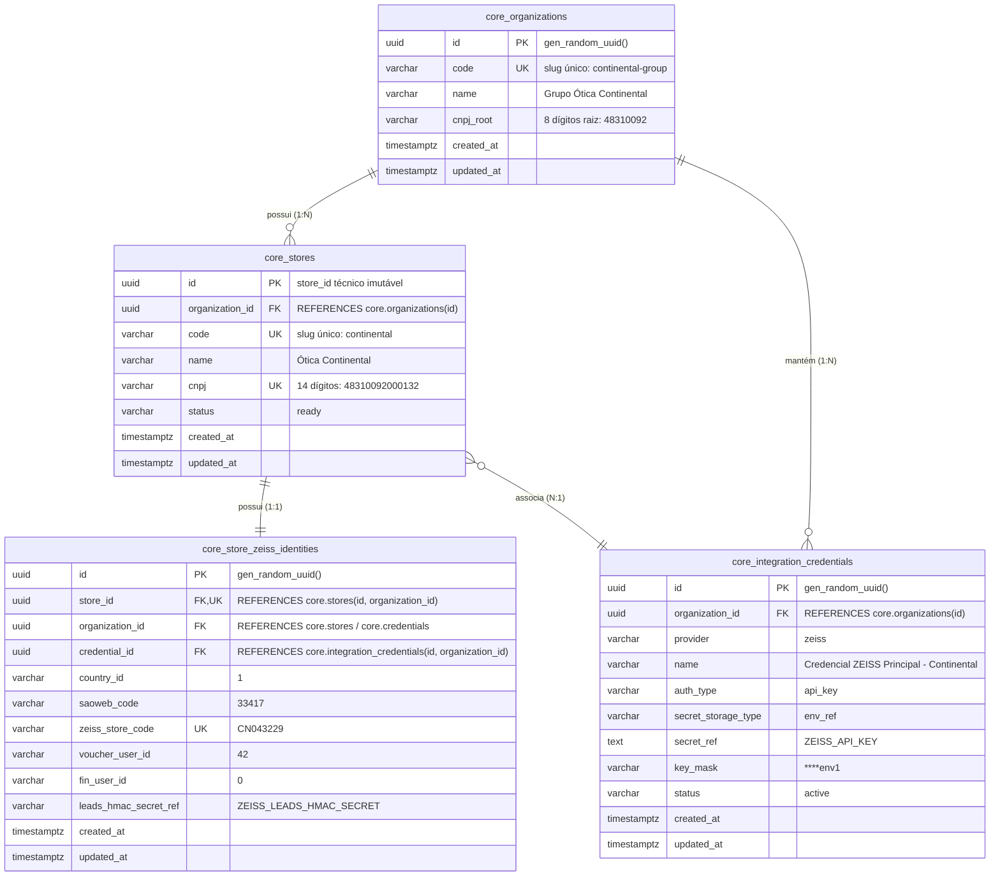

# BD_API_ZEISS — Documentação Canônica: Fundação Multi-Loja (Fase ML-002A)

**Data de Conclusão e Validação:** 19 de Outubro de 2026  
**Status:** IMPLANTADO E HOMOLOGADO EM BANCO REAL  
**Projeto:** `C:\Antigravity\BD_API_ZEISS`  
**Supabase Canônico:** `BD_API_ZEISS` (ref: `bklpztydqllqevekgins`)  
**Autor:** Antigravity Architect Agent  

---

## 1. VISÃO GERAL DA IMPLANTAÇÃO

A fase **ML-002A (Fundação Multi-Loja)** foi implementada e validada com sucesso no PostgreSQL do Supabase dedicado. Foi criado o schema canônico **`core`**, estabelecendo as entidades relacionais para governança de organizações, lojas, credenciais de integração seguras e identidades operacionais ZEISS, com estrito isolamento por tenant e proteção de dados.

### 1.1 Resumo dos Componentes Implantados

1. **Schema `core`**: Isolado com Row Level Security (RLS) e restrição total para papéis públicos.
2. **`core.organizations`**: Cadastro de franqueadoras, redes óticas ou grupos econômicos.
3. **`core.stores`**: Cadastro de unidades operacionais com o `store_id UUID` técnico imutável e validação cadastral de CNPJ (14 dígitos).
4. **`core.integration_credentials`**: Gerenciamento de credenciais com referências seguras (`secret_storage_type = 'env_ref'`) e mascaramento (`key_mask`), sem nenhuma chave em texto plano no banco.
5. **`core.store_zeiss_identities`**: Identidades contratuais ZEISS com **Foreign Keys Compostas** `(store_id, organization_id)` e `(credential_id, organization_id)`, garantindo matematicamente a impossibilidade de vincular lojas a credenciais de outras organizações.
6. **Provisionamento Inicial da Continental**: Cadastrada com sucesso (`CNPJ: 48310092000132`, `SAOWEB: 33417`, `Store Code: CN043229`, `Status: ready`).
7. **Preservação de Dados Históricos**: **Zero mutações em `zeiss.orders` (7.180 pedidos inalterados)** e em todas as tabelas operacionais legadas.

---

## 2. MODELO DE DADOS EFETIVAMENTE IMPLANTADO



### 2.2 Dicionário de Tabelas e Constraints Confirmadas em Catálogo

#### Tabela `core.organizations`
- `id UUID PRIMARY KEY DEFAULT gen_random_uuid()`
- `code VARCHAR(50) NOT NULL UNIQUE` (slug de minúsculas e hífens)
- `name VARCHAR(255) NOT NULL`
- `cnpj_root VARCHAR(8) NULL` (8 dígitos numéricos)
- Constraints:
  - `organizations_pkey`: `PRIMARY KEY (id)`
  - `uq_core_organizations_code`: `UNIQUE (code)`
  - `chk_core_org_code_format`: `CHECK (code ~ '^[a-z0-9][a-z0-9_-]{1,48}[a-z0-9]$')`
  - `chk_core_org_cnpj_root`: `CHECK (cnpj_root IS NULL OR cnpj_root ~ '^[0-9]{8}$')`

#### Tabela `core.integration_credentials`
- `id UUID PRIMARY KEY DEFAULT gen_random_uuid()`
- `organization_id UUID NOT NULL REFERENCES core.organizations(id) ON DELETE RESTRICT`
- `provider VARCHAR(50) NOT NULL DEFAULT 'zeiss'`
- `name VARCHAR(100) NOT NULL`
- `auth_type VARCHAR(30) NOT NULL DEFAULT 'api_key'`
- `secret_storage_type VARCHAR(30) NOT NULL DEFAULT 'env_ref'`
- `secret_ref TEXT NOT NULL`
- `key_mask VARCHAR(20) NOT NULL`
- `status VARCHAR(30) NOT NULL DEFAULT 'active'`
- Constraints:
  - `integration_credentials_pkey`: `PRIMARY KEY (id)`
  - `uq_core_credentials_id_org`: `UNIQUE (id, organization_id)`
  - `chk_core_cred_auth_type`: `CHECK (auth_type IN ('api_key', 'oauth2', 'mtls'))`
  - `chk_core_cred_storage_type`: `CHECK (secret_storage_type IN ('env_ref', 'encrypted', 'vault_ref'))`
  - `chk_core_cred_status`: `CHECK (status IN ('active', 'revoked', 'expired'))`
  - `chk_core_cred_key_mask`: `CHECK (key_mask ~ '^\*{4}[0-9A-Za-z_-]{2,10}$')`

#### Tabela `core.stores`
- `id UUID PRIMARY KEY DEFAULT gen_random_uuid()` (o `store_id` canônico)
- `organization_id UUID NOT NULL REFERENCES core.organizations(id) ON DELETE RESTRICT`
- `code VARCHAR(50) NOT NULL UNIQUE` (slug de minúsculas)
- `name VARCHAR(255) NOT NULL`
- `cnpj VARCHAR(14) NOT NULL UNIQUE` (14 dígitos numéricos)
- `status VARCHAR(30) NOT NULL DEFAULT 'draft'`
- Constraints:
  - `stores_pkey`: `PRIMARY KEY (id)`
  - `uq_core_stores_code`: `UNIQUE (code)`
  - `uq_core_stores_cnpj`: `UNIQUE (cnpj)`
  - `uq_core_stores_id_org`: `UNIQUE (id, organization_id)`
  - `chk_core_stores_code_format`: `CHECK (code ~ '^[a-z0-9][a-z0-9_-]{1,48}[a-z0-9]$')`
  - `chk_core_stores_cnpj_digits`: `CHECK (cnpj ~ '^[0-9]{14}$')`
  - `chk_core_stores_status`: `CHECK (status IN ('draft', 'validating', 'ready', 'active', 'suspended', 'error'))`

#### Tabela `core.store_zeiss_identities`
- `id UUID PRIMARY KEY DEFAULT gen_random_uuid()`
- `store_id UUID NOT NULL UNIQUE`
- `organization_id UUID NOT NULL`
- `credential_id UUID NOT NULL`
- `country_id VARCHAR(10) NOT NULL DEFAULT '1'`
- `saoweb_code VARCHAR(50) NOT NULL`
- `zeiss_store_code VARCHAR(50) NOT NULL UNIQUE`
- `voucher_user_id VARCHAR(50) NOT NULL`
- `fin_user_id VARCHAR(50) NOT NULL DEFAULT '0'`
- `leads_hmac_secret_ref VARCHAR(255) NULL`
- Constraints:
  - `store_zeiss_identities_pkey`: `PRIMARY KEY (id)`
  - `uq_core_store_identities_store_id`: `UNIQUE (store_id)`
  - `uq_core_store_identities_zeiss_code`: `UNIQUE (zeiss_store_code)`
  - **`fk_core_identities_store_org`**: `FOREIGN KEY (store_id, organization_id) REFERENCES core.stores(id, organization_id) ON DELETE RESTRICT`
  - **`fk_core_identities_credential_org`**: `FOREIGN KEY (credential_id, organization_id) REFERENCES core.integration_credentials(id, organization_id) ON DELETE RESTRICT`
  - `chk_core_zeiss_country_id`: `CHECK (country_id ~ '^[0-9]{1,4}$')`
  - `chk_core_zeiss_saoweb`: `CHECK (saoweb_code ~ '^[0-9]{1,10}$')`
  - `chk_core_zeiss_store_code`: `CHECK (zeiss_store_code ~ '^[A-Za-z0-9_-]{2,50}$')`
  - `chk_core_zeiss_voucher_user`: `CHECK (voucher_user_id ~ '^[0-9]{1,10}$')`
  - `chk_core_zeiss_fin_user`: `CHECK (fin_user_id ~ '^[0-9]{1,10}$')`

---

## 3. CONTRATOS, RELACIONAMENTOS E ISOLAMENTO MULTI-ORGANIZAÇÃO

### 3.1 Garantia de Não-Mistura de Credenciais por Chave Estrangeira Composta
A inclusão de `organization_id` na tupla da identidade técnica (`store_zeiss_identities`) permitiu a criação de duas chaves estrangeiras compostas:
1. `(store_id, organization_id)` aponta para `core.stores(id, organization_id)`.
2. `(credential_id, organization_id)` aponta para `core.integration_credentials(id, organization_id)`.

**Efeito de Segurança**: O PostgreSQL impede em nível de engine que qualquer operador ou script associe a Loja A de uma rede a uma Credencial B pertencente a outra rede. A tentativa resultará imediatamente em erro de integridade referencial (`foreign_key_violation`).

### 3.2 Cenários Suportados de Credenciais
- **Credencial Compartilhada no Grupo (1:N)**: Múltiplas filiais da mesma organização apontam para a mesma `credential_id`. Compartilham a mesma `x-api-key` emitida pela ZEISS para o grupo corporativo, mantendo `saoweb_code`, `cnpj` e `zeiss_store_code` individualizados por loja.
- **Credencial Exclusiva por Loja (1:1)**: Lojas parceiras ou autônomas possuem sua própria linha em `core.integration_credentials`.

---

## 4. SEGURANÇA E MATRIZ DE PERMISSÕES

O schema `core` foi protegido com Row Level Security (RLS) e grants explícitos:

| Papel de Banco | Privilégios | Políticas RLS Ativas | Justificativa |
|---|---|---|---|
| **`PUBLIC` / `anon`** | **REVOKE ALL** | Nenhuma política (acesso negado) | Aplicações anônimas não acessam infraestrutura ou cadastros internos. |
| **`authenticated`** | **REVOKE ALL** | Nenhuma política (acesso negado) | Usuários logados comuns não têm acesso aos metadados do core. |
| **`bd_api_zeiss_worker`** | `SELECT` | `worker_select_organizations`<br/>`worker_select_stores`<br/>`worker_select_credentials`<br/>`worker_select_identities` | Worker possui permissão estrita de leitura para identificar lojas ativas e mapear chaves. |
| **`service_role`** | `ALL` | `service_role_all_organizations`<br/>`service_role_all_stores`<br/>`service_role_all_credentials`<br/>`service_role_all_identities` | Role administrativa do Supabase para provisionamento, DDL e onboarding de lojas. |

---

## 5. PROCEDIMENTO DE CADASTRO DE UMA NOVA LOJA (SEM NOVO DEPLOY)

Para cadastrar uma nova unidade operacional sem alterar o código ou realizar deploy:

```sql
DO $$
DECLARE
    v_org_id UUID;
    v_cred_id UUID;
    v_store_id UUID;
BEGIN
    -- 1. Obter ou cadastrar a Organização
    SELECT id INTO v_org_id FROM core.organizations WHERE code = 'nome-da-organizacao';
    
    -- 2. Obter ou cadastrar a Credencial ZEISS da Organização
    SELECT id INTO v_cred_id FROM core.integration_credentials 
    WHERE organization_id = v_org_id AND name = 'Nome da Credencial' LIMIT 1;
    
    -- 3. Inserir a Nova Loja (Status inicial: 'draft' ou 'ready')
    INSERT INTO core.stores (
        organization_id, code, name, cnpj, status
    ) VALUES (
        v_org_id, 'codigo-amigavel-loja', 'Ótica Nova Loja', '12345678000199', 'draft'
    ) RETURNING id INTO v_store_id;

    -- 4. Inserir a Identidade ZEISS da Loja (FK composta valida org_id automaticamente)
    INSERT INTO core.store_zeiss_identities (
        store_id, organization_id, credential_id,
        country_id, saoweb_code, zeiss_store_code,
        voucher_user_id, fin_user_id, leads_hmac_secret_ref
    ) VALUES (
        v_store_id, v_org_id, v_cred_id,
        '1', '99123', 'CN099123',
        '42', '0', 'ZEISS_LEADS_HMAC_SECRET'
    );
END $$;
```

---

## 6. LIMITAÇÕES TRANSITÓRIAS ATÉ A FASE ML-002B

Como o escopo da ML-002A foi estritamente a fundação cadastral e relacional, as seguintes limitações são vigentes e serão solucionadas na **ML-002B**:

1. **Tabelas Operacionais `zeiss.*` ainda não possuem a coluna `store_id`**:
   - `zeiss.orders`, `zeiss.order_details`, `zeiss.tracking_events`, `zeiss.receivables`, `zeiss.campaigns` continuam operando sem `store_id`.
   - Os 7.180 pedidos históricos permanecem sem atribuição técnica de loja.
2. **Sincronização do Worker ainda opera via `process.env`**:
   - O worker existente continua executando one-shot ticks utilizando as variáveis estáticas de ambiente. A nova loja cadastrada não será automaticamente sincronizada pelo worker até a refatoração da engine na fase **ML-002C**.
3. **Resolução Dinâmica de Segredos (`secret_storage_type`)**:
   - Atualmente, apenas o tipo `'env_ref'` é resolvido (via variáveis de ambiente existentes). A resolução dinâmica em tempo de execução via envelope criptografado (`pgcrypto`) ou cofre de chaves será introduzida na camada de serviços do Node.js na fase **ML-002C**.

---

*Fim da Documentação Canônica ML-002A.*
