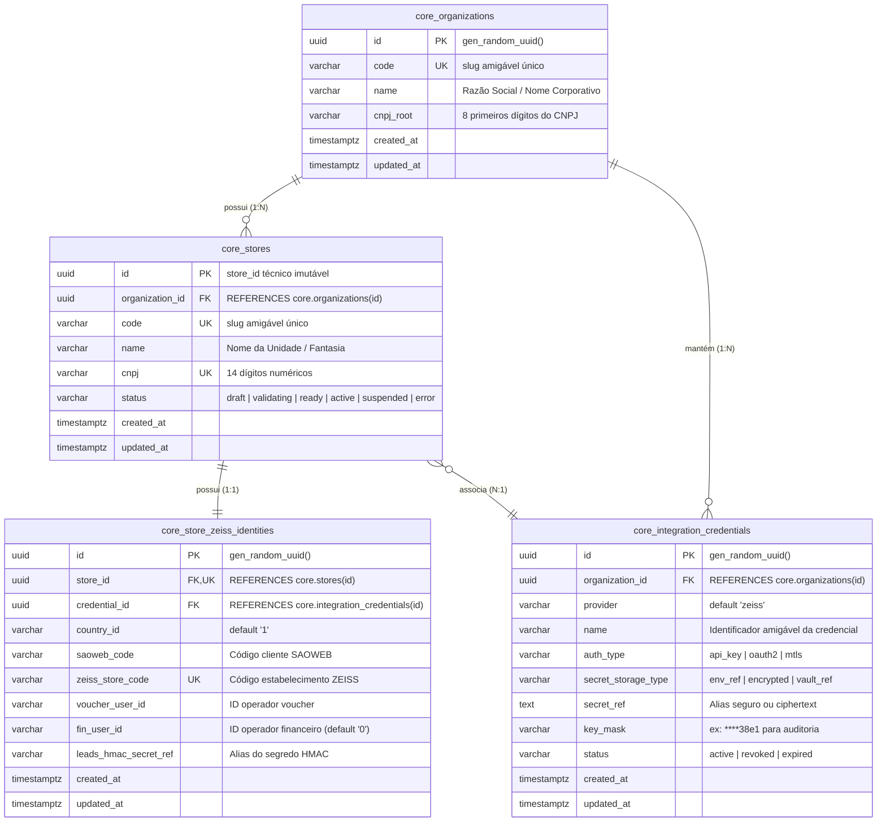
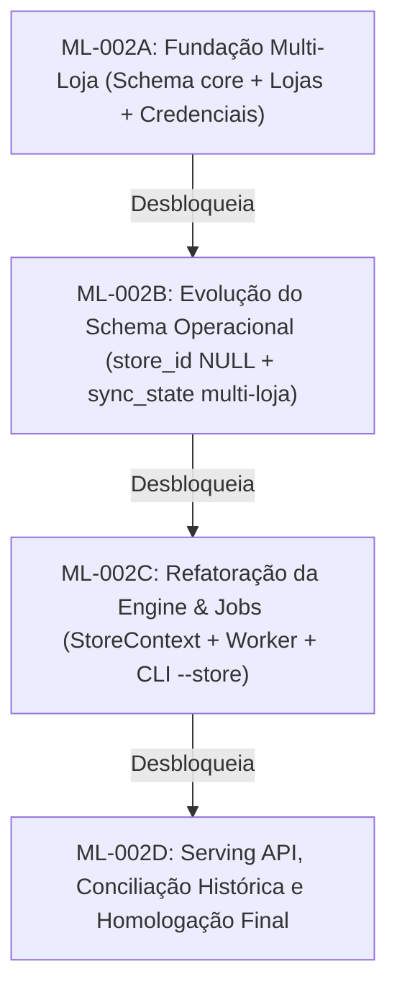

# BD_API_ZEISS — Especificação Técnica ML-002A
## Fundação Multi-Loja: Schema Core, Governança Organizacional e Gestão Segura de Credenciais

**Data:** 19 de Outubro de 2026  
**Status:** PLANEJAMENTO / ESPECIFICAÇÃO TÉCNICA (Aguardando Aprovação)  
**Projeto:** `C:\Antigravity\BD_API_ZEISS`  
**Supabase Canônico:** `BD_API_ZEISS` (ref: `bklpztydqllqevekgins`)  
**Documento de Referência Obrigatória:** `docs/architecture/ML-001_AUDITORIA_ARQUITETURA_MULTI_LOJA.md`  
**Autor:** Antigravity Architect Agent  

---

## 1. RESUMO EXECUTIVO E ESCOPO DA FASE ML-002A

A fase **ML-002A** estabelece a **Fundação Multi-Loja** da plataforma BD_API_ZEISS, criando a infraestrutura relacional, permissões e mecanismos de segurança para permitir que a plataforma suporte múltiplas organizações, lojas e credenciais de integração.

### 1.1 Decisões Arquiteturais e Restrições Rígidas Desta Fase

Em conformidade com a aprovação da fase ML-001 e as diretrizes explícitas do projeto:

1. **`store_id UUID` como Identidade Técnica Imutável**: A identidade canônica de cada loja será um `UUID v4` imutável (`core.stores.id`).
2. **CNPJ como Atributo Cadastral**: O CNPJ (`14 dígitos`) é um atributo da loja, com validação de formato e unicidade cadastral, nunca a chave primária.
3. **Isolamento Lógico em Schema Único**: Rejeita-se a criação de schemas de banco separados por loja. A plataforma utiliza isolamento relacional por tenant (`store_id`) com RLS dentro do mesmo catálogo.
4. **Zero Impacto nos 7.180 Pedidos Históricos**:
   - Os registros históricos em `zeiss.orders` e tabelas correlatas **permanecerão estritamente sem atribuição nesta fase** (`store_id` não é criado nem forçado agora).
   - **NÃO será criada nenhuma unidade fictícia `legacy-unassigned`**.
   - Nenhuma linha existente no banco sofrerá alteração ou mutação de dados.
5. **Preservação Integral de Constraints Existentes**: Nenhuma constraint existente (`zeiss.orders_order_number_key`, etc.) será alterada, removida ou substituída nesta fase.
6. **Zero Impacto no Runtime e na Engine**: Nenhum arquivo em `src/engine/*`, `src/providers/*`, `src/jobs/*`, `src/worker.ts` ou `src/cli/*` será alterado nesta etapa.
7. **Zero Impacto na Autenticação de Consumidores**: A autenticação em `integration.api_consumers` e `integration.api_credentials` permanece 100% inalterada.
8. **Segurança Absoluta de Credenciais**: Nenhuma chave de API ZEISS ou segredo será gravado em texto plano no banco de dados nem exposto em logs ou relatórios.
9. **Extensibilidade Sem Novos Deploys**: A estrutura permitirá que futuras lojas sejam inseridas, validadas e associadas a credenciais via DDL/DML, sem exigir novo build ou deploy da aplicação.

---

## 2. MODELO DE DADOS DEFINITIVO PROPOSTO (`schema core`)

Propõe-se a criação do schema **`core`**, isolado dos schemas operacionais (`zeiss`), de infraestrutura de sincronização (`integration`) e de auditoria (`audit`).



### 2.1 Especificação Detalhada das Tabelas

#### 2.1.1 Tabela `core.organizations`
Representa a pessoa jurídica controladora, rede de franquias ou grupo econômico.
- **`id` (UUID, PK)**: Identificador único gerado via `gen_random_uuid()`.
- **`code` (VARCHAR(50), UNIQUE, NOT NULL)**: Slug padronizado (ex: `'continental-group'`).
  - Constraint: `chk_org_code_format CHECK (code ~ '^[a-z0-9][a-z0-9_-]{1,48}[a-z0-9]$')`.
- **`name` (VARCHAR(255), NOT NULL)**: Razão social ou denominação corporativa.
- **`cnpj_root` (VARCHAR(8), NULL)**: Raiz de 8 dígitos do CNPJ para identificação da matriz fiscal.
  - Constraint: `chk_org_cnpj_root CHECK (cnpj_root IS NULL OR cnpj_root ~ '^[0-9]{8}$')`.
- **`created_at` / `updated_at` (TIMESTAMPTZ, NOT NULL)**: Timestamps de auditoria.

#### 2.1.2 Tabela `core.stores`
Representa a unidade física ou filial ótica (o estabelecimento).
- **`id` (UUID, PK)**: O `store_id` técnico imutável.
- **`organization_id` (UUID, FK, NOT NULL)**: Referência a `core.organizations(id)` com `ON DELETE RESTRICT`.
- **`code` (VARCHAR(50), UNIQUE, NOT NULL)**: Slug amigável único no sistema (ex: `'continental'`).
  - Constraint: `chk_store_code_format CHECK (code ~ '^[a-z0-9][a-z0-9_-]{1,48}[a-z0-9]$')`.
- **`name` (VARCHAR(255), NOT NULL)**: Nome fantasia ou operacional da unidade.
- **`cnpj` (VARCHAR(14), UNIQUE, NOT NULL)**: Cadastro Nacional da Pessoa Jurídica da filial (14 dígitos sem formatação).
  - Constraint: `chk_store_cnpj_digits CHECK (cnpj ~ '^[0-9]{14}$')`.
- **`status` (VARCHAR(30), NOT NULL, DEFAULT `'draft'`)**:
  - Constraint: `chk_store_status CHECK (status IN ('draft', 'validating', 'ready', 'active', 'suspended', 'error'))`.
- **`created_at` / `updated_at` (TIMESTAMPTZ, NOT NULL)**: Timestamps de auditoria.

#### 2.1.3 Tabela `core.integration_credentials`
Mecanismo central de armazenamento e referência a credenciais de integração com a ZEISS.
- **`id` (UUID, PK)**: Identificador único da credencial.
- **`organization_id` (UUID, FK, NOT NULL)**: Referência à organização dona do contrato ZEISS (`ON DELETE RESTRICT`).
- **`provider` (VARCHAR(50), NOT NULL, DEFAULT `'zeiss'`)**: Provedor de integração.
- **`name` (VARCHAR(100), NOT NULL)**: Rótulo amigável (ex: `'Credencial Master Rede Continental'`).
- **`auth_type` (VARCHAR(30), NOT NULL, DEFAULT `'api_key'`)**:
  - Constraint: `chk_cred_auth_type CHECK (auth_type IN ('api_key', 'oauth2', 'mtls'))`.
- **`secret_storage_type` (VARCHAR(30), NOT NULL, DEFAULT `'env_ref'`)**:
  - Constraint: `chk_cred_storage_type CHECK (secret_storage_type IN ('env_ref', 'encrypted', 'vault_ref'))`.
- **`secret_ref` (TEXT, NOT NULL)**:
  - Quando `env_ref`: Nome da variável de ambiente no worker (ex: `'ZEISS_API_KEY'`).
  - Quando `encrypted`: Envelope binário codificado em Base64 criptografado via `pgp_sym_encrypt`.
  - Quando `vault_ref`: URI ou chave referencial no cofre de segredos externo.
- **`key_mask` (VARCHAR(20), NOT NULL)**:
  - Sufixo visível para auditoria administrativa sem exposição de segredos (ex: `'****4a2f'`).
  - Constraint: `chk_cred_key_mask CHECK (key_mask ~ '^\*{4}[0-9A-Za-z_-]{2,10}$')`.
- **`status` (VARCHAR(30), NOT NULL, DEFAULT `'active'`)**:
  - Constraint: `chk_cred_status CHECK (status IN ('active', 'revoked', 'expired'))`.
- **`created_at` / `updated_at` (TIMESTAMPTZ, NOT NULL)**: Timestamps de auditoria.

#### 2.1.4 Tabela `core.store_zeiss_identities`
Contém a tupla técnica de identificadores contratuais exigidos pela ZEISS para roteamento de chamadas.
- **`id` (UUID, PK)**: Identificador único da identidade de integração.
- **`store_id` (UUID, FK, UNIQUE, NOT NULL)**: Vínculo 1:1 estrito com `core.stores(id)` (`ON DELETE RESTRICT`).
- **`credential_id` (UUID, FK, NOT NULL)**: Vínculo com a credencial a ser utilizada (`ON DELETE RESTRICT`).
- **`country_id` (VARCHAR(10), NOT NULL, DEFAULT `'1'`)**: Código do país na federação ZEISS (Brasil = `'1'`).
  - Constraint: `chk_zeiss_country_id CHECK (country_id ~ '^[0-9]{1,4}$')`.
- **`saoweb_code` (VARCHAR(50), NOT NULL)**: Código do cliente no sistema SAOWEB da ZEISS (ex: `'33417'`).
  - Constraint: `chk_zeiss_saoweb CHECK (saoweb_code ~ '^[0-9]{1,10}$')`.
- **`zeiss_store_code` (VARCHAR(50), UNIQUE, NOT NULL)**: Código da loja ZEISS (ex: `'CN043229'`).
  - Constraint: `chk_zeiss_store_code CHECK (zeiss_store_code ~ '^[A-Za-z0-9_-]{2,50}$')`.
- **`voucher_user_id` (VARCHAR(50), NOT NULL)**: ID do usuário para resgate de vouchers (ex: `'42'`).
  - Constraint: `chk_zeiss_voucher_user CHECK (voucher_user_id ~ '^[0-9]{1,10}$')`.
- **`fin_user_id` (VARCHAR(50), NOT NULL, DEFAULT `'0'`)**: ID do usuário para boletos no financeiro (ex: `'0'`).
  - Constraint: `chk_zeiss_fin_user CHECK (fin_user_id ~ '^[0-9]{1,10}$')`.
- **`leads_hmac_secret_ref` (VARCHAR(255), NULL)**: Alias seguro para a chave HMAC de anonimização de e-mails de leads (ex: `'ZEISS_LEADS_HMAC_SECRET'`).
- **`created_at` / `updated_at` (TIMESTAMPTZ, NOT NULL)**: Timestamps de auditoria.

---

## 3. RELACIONAMENTO: ORGANIZAÇÃO, LOJA, CNPJ, CÓDIGOS ZEISS E CREDENCIAIS COMPARTILHADAS

A arquitetura resolve com precisão o problema do compartilhamento ou segregação de credenciais:

```
[Organização: Rede Continental]
  │
  ├── [Credencial Master: x-api-key Contrato Grupo] (core.integration_credentials)
  │     │
  │     ├── Loja 01: Continental Matriz (CNPJ: 48.310.092/0001-32)
  │     │     └── Identidade ZEISS: { saoweb: 33417, store_code: CN043229 } ──┐
  │     │                                                                       │ Compartilham a
  │     └── Loja 02: Continental Filial (CNPJ: 48.310.092/0002-13)             │ mesma credencial
  │           └── Identidade ZEISS: { saoweb: 33418, store_code: CN043230 } ──┘
  │
  └── [Credencial Específica: Loja Parceira Independente]
        └── Loja 03: Ótica Parceira (CNPJ: 12.345.678/0001-90)
              └── Identidade ZEISS: { saoweb: 99123, store_code: CN088712 }
```

### Regras de Integridade e Cardinalidade:
1. **Organização $\rightarrow$ Lojas (`1 : N`)**: Uma organização pode possuir de uma a centenas de lojas.
2. **Organização $\rightarrow$ Credenciais (`1 : N`)**: Uma organização pode cadastrar múltiplas credenciais (ex: chave para pedidos, chave específica para financeiro ou chaves de contratos distintos).
3. **Loja $\rightarrow$ Identidade ZEISS (`1 : 1`)**: Toda loja possui exatamente uma tupla operacional perante a ZEISS.
4. **Identidade ZEISS $\rightarrow$ Credencial (`N : 1`)**:
   - **Cenário de Credencial Compartilhada**: Múltiplas lojas apontam para a mesma `credential_id`. Ambas utilizam a mesma `x-api-key` emitida pela ZEISS para o grupo econômico, mas mantêm seus `cnpj`, `saoweb_code` e `zeiss_store_code` rigorosamente segregados.
   - **Cenário de Credencial Isolada**: Cada loja aponta para sua própria `credential_id` dedicada.

---

## 4. MECANISMO DE REFERÊNCIAS SEGURAS ÀS CREDENCIAIS ZEISS

Para atender à exigência obrigatória de **não divulgar segredos em texto plano nem em relatórios**:

### 4.1 Estratégia Híbrida de Armazenamento Seguro

| Tipo de Armazenamento (`secret_storage_type`) | O que é gravado em `secret_ref` | Como o Runtime consome | Vantagens Operacionais |
|---|---|---|---|
| **`env_ref` (Padrão de Transição)** | Nome da variável de ambiente no worker (ex: `'ZEISS_API_KEY'`) | O runtime lê `process.env[cred.secret_ref]` | **Zero risco de vazamento em banco**. Compatibilidade imediata com o ambiente existente sem expor nenhuma chave. |
| **`encrypted` (Envelope Pgcrypto)** | Ciphertext Base64 encriptado simetricamente | Descriptografado via função segura ou chave mestra em memória do worker | Permite inclusão de novas lojas dinamicamente sem alterar arquivos `.env` ou reiniciar containers. |
| **`vault_ref` (Cofre Externo)** | URI ou Chave do Secret Manager | Runtime busca do cofre AWS / Vault / Supabase | Preparado para infraestruturas corporativas enterprise. |

### 4.2 Mascaramento para Auditoria Administrativa
- A coluna `key_mask` (ex: `'****4a2f'`) permite que operadores e administradores confirmem visualmente se a credencial cadastrada corresponde à chave fornecida pela ZEISS sem jamais expor o conteúdo sensível.
- A função de auditoria administrativa `core.get_credentials_metadata()` é criada como `SECURITY DEFINER` retornando estritamente metadados sanitizados (sem `secret_ref`).

---

## 5. ESTRATÉGIA DE CADASTRO INICIAL DA LOJA CONTINENTAL

### 5.1 Parâmetros Operacionais Auditados da Continental
Os dados canônicos confirmados na fase ML-001 são:
- **Organização**: Continental Grupo Ótico (`code: 'continental-group'`).
- **Loja**: Ótica Continental (`code: 'continental'`).
- **CNPJ**: `48310092000132`.
- **Status Inicial**: `'ready'` (loja homologada e apta para operações).
- **Código SAOWEB**: `33417`.
- **Código de Loja ZEISS**: `CN043229`.
- **Country ID**: `1`.
- **Voucher User ID**: `42`.
- **Fin User ID**: `0`.
- **Referência da Credencial**: `ZEISS_API_KEY` (`secret_storage_type: 'env_ref'`).
- **Referência do Segredo HMAC**: `ZEISS_LEADS_HMAC_SECRET`.

### 5.2 Preservação Rigorosa dos 7.180 Pedidos Históricos

> [!CAUTION]
> **Garantia de Isolamento Histórico**:
> - O script de cadastro da Continental **NÃO executa nenhum comando de `UPDATE`, `INSERT` ou `DELETE` nas tabelas `zeiss.orders`, `zeiss.order_details`, `zeiss.tracking_events` ou `zeiss.receivables`**.
> - Os 7.180 pedidos históricos permanecem exatamente como estão hoje.
> - Não é criada nenhuma loja fictícia `legacy-unassigned`.
> - A reconciliação ou atribuição futura dos registros históricos à Continental dependerá exclusivamente de um plano posterior e autorização explícita com comprovação fiscal na fase ML-002D.

---

## 6. PRESERVAÇÃO DAS CREDENCIAIS EXISTENTES DURANTE A TRANSIÇÃO

A transição é desenhada para ter **zero disrupção**:

1. O arquivo `.env.local` e as variáveis do processo Node.js continuam provendo:
   - `ZEISS_API_KEY`
   - `ZEISS_COUNTRY_ID`
   - `ZEISS_CNPJ`
   - `ZEISS_STORE_ID`
   - `ZEISS_SAOWEB_CODE`
   - `ZEISS_VOUCHER_USER_ID`
   - `ZEISS_FIN_USER_ID`
   - `ZEISS_LEADS_HMAC_SECRET`
2. O código existente em `src/config/config.ts` e `src/worker.ts` **não é tocado na ML-002A**.
3. O cadastro em `core.integration_credentials` aponta para `secret_ref = 'ZEISS_API_KEY'` via tipo `'env_ref'`.
4. Assim, o runtime atual continua executando seus jobs diários perfeitamente, enquanto o banco ganha a fundação multi-loja pronta para a futura transição da engine.

---

## 7. MATRIZ DE PERMISSÕES, RLS E SEGURANÇA

Todas as tabelas do schema `core` terão **Row Level Security (RLS) habilitada** por padrão:

| Role Supabase | `core.organizations` | `core.stores` | `core.integration_credentials` | `core.store_zeiss_identities` | Justificativa de Segurança |
|---|---|---|---|---|---|
| **`anon`** | **NENHUM (REVOKE ALL)** | **NENHUM (REVOKE ALL)** | **NENHUM (REVOKE ALL)** | **NENHUM (REVOKE ALL)** | Acesso anônimo estritamente proibido. |
| **`authenticated`** | **NENHUM (REVOKE ALL)** | **NENHUM (REVOKE ALL)** | **NENHUM (REVOKE ALL)** | **NENHUM (REVOKE ALL)** | Usuários autenticados comuns não acessam o core. |
| **`bd_api_zeiss_worker`** | `SELECT` | `SELECT` | `SELECT` | `SELECT` | Worker lê metadados de lojas e referências de credenciais para execução. |
| **`service_role`** | `ALL` | `ALL` | `ALL` | `ALL` | Role administrativa para provisionamento e onboarding. |

### Políticas de RLS Propostas:
```sql
-- Habilitar RLS em todas as tabelas core
ALTER TABLE core.organizations ENABLE ROW LEVEL SECURITY;
ALTER TABLE core.stores ENABLE ROW LEVEL SECURITY;
ALTER TABLE core.integration_credentials ENABLE ROW LEVEL SECURITY;
ALTER TABLE core.store_zeiss_identities ENABLE ROW LEVEL SECURITY;

-- Políticas para bd_api_zeiss_worker
CREATE POLICY worker_select_organizations ON core.organizations FOR SELECT TO bd_api_zeiss_worker USING (true);
CREATE POLICY worker_select_stores ON core.stores FOR SELECT TO bd_api_zeiss_worker USING (true);
CREATE POLICY worker_select_credentials ON core.integration_credentials FOR SELECT TO bd_api_zeiss_worker USING (true);
CREATE POLICY worker_select_identities ON core.store_zeiss_identities FOR SELECT TO bd_api_zeiss_worker USING (true);

-- Políticas para service_role (administração total)
CREATE POLICY service_role_all_organizations ON core.organizations FOR ALL TO service_role USING (true) WITH CHECK (true);
CREATE POLICY service_role_all_stores ON core.stores FOR ALL TO service_role USING (true) WITH CHECK (true);
CREATE POLICY service_role_all_credentials ON core.integration_credentials FOR ALL TO service_role USING (true) WITH CHECK (true);
CREATE POLICY service_role_all_identities ON core.store_zeiss_identities FOR ALL TO service_role USING (true) WITH CHECK (true);
```

---

## 8. SQL COMPLETO DAS MIGRATIONS PROPOSTAS (NÃO EXECUTADAS)

As migrations foram divididas em duas unidades atômicas, incrementais e perfeitamente reversíveis.

### 8.1 Migration 1: `20261020100000_core_multi_store_foundation.sql`

```sql
-- ==============================================================================
-- BD_API_ZEISS — Migration: 20261020100000_core_multi_store_foundation.sql
-- Fase: ML-002A (Fundação Multi-Loja)
-- Objetivo: Criação do schema core, organizações e tabela segura de credenciais.
-- Idempotente e reversível.
-- ==============================================================================

BEGIN;

-- 1. Criação do Schema Core
CREATE SCHEMA IF NOT EXISTS core;

-- Garantir que anon e authenticated não tenham privilégios por padrão
REVOKE ALL ON SCHEMA core FROM PUBLIC, anon, authenticated;
GRANT USAGE ON SCHEMA core TO bd_api_zeiss_worker, service_role;

-- 2. Tabela core.organizations
CREATE TABLE IF NOT EXISTS core.organizations (
    id UUID PRIMARY KEY DEFAULT gen_random_uuid(),
    code VARCHAR(50) NOT NULL,
    name VARCHAR(255) NOT NULL,
    cnpj_root VARCHAR(8) NULL,
    created_at TIMESTAMPTZ NOT NULL DEFAULT CURRENT_TIMESTAMP,
    updated_at TIMESTAMPTZ NOT NULL DEFAULT CURRENT_TIMESTAMP,
    CONSTRAINT uq_core_organizations_code UNIQUE (code),
    CONSTRAINT chk_core_org_code_format CHECK (code ~ '^[a-z0-9][a-z0-9_-]{1,48}[a-z0-9]$'),
    CONSTRAINT chk_core_org_cnpj_root CHECK (cnpj_root IS NULL OR cnpj_root ~ '^[0-9]{8}$')
);

-- 3. Tabela core.integration_credentials
CREATE TABLE IF NOT EXISTS core.integration_credentials (
    id UUID PRIMARY KEY DEFAULT gen_random_uuid(),
    organization_id UUID NOT NULL REFERENCES core.organizations(id) ON DELETE RESTRICT,
    provider VARCHAR(50) NOT NULL DEFAULT 'zeiss',
    name VARCHAR(100) NOT NULL,
    auth_type VARCHAR(30) NOT NULL DEFAULT 'api_key',
    secret_storage_type VARCHAR(30) NOT NULL DEFAULT 'env_ref',
    secret_ref TEXT NOT NULL,
    key_mask VARCHAR(20) NOT NULL,
    status VARCHAR(30) NOT NULL DEFAULT 'active',
    created_at TIMESTAMPTZ NOT NULL DEFAULT CURRENT_TIMESTAMP,
    updated_at TIMESTAMPTZ NOT NULL DEFAULT CURRENT_TIMESTAMP,
    CONSTRAINT chk_core_cred_auth_type CHECK (auth_type IN ('api_key', 'oauth2', 'mtls')),
    CONSTRAINT chk_core_cred_storage_type CHECK (secret_storage_type IN ('env_ref', 'encrypted', 'vault_ref')),
    CONSTRAINT chk_core_cred_status CHECK (status IN ('active', 'revoked', 'expired')),
    CONSTRAINT chk_core_cred_key_mask CHECK (key_mask ~ '^\*{4}[0-9A-Za-z_-]{2,10}$')
);

-- Índices de Performance
CREATE INDEX IF NOT EXISTS idx_core_credentials_org ON core.integration_credentials(organization_id);
CREATE INDEX IF NOT EXISTS idx_core_credentials_status ON core.integration_credentials(status);

-- 4. Habilitar RLS
ALTER TABLE core.organizations ENABLE ROW LEVEL SECURITY;
ALTER TABLE core.integration_credentials ENABLE ROW LEVEL SECURITY;

-- 5. Conceder Permissões
GRANT SELECT ON core.organizations TO bd_api_zeiss_worker;
GRANT SELECT ON core.integration_credentials TO bd_api_zeiss_worker;

GRANT ALL ON core.organizations TO service_role;
GRANT ALL ON core.integration_credentials TO service_role;

-- 6. Políticas de RLS
DROP POLICY IF EXISTS worker_select_organizations ON core.organizations;
CREATE POLICY worker_select_organizations ON core.organizations FOR SELECT TO bd_api_zeiss_worker USING (true);

DROP POLICY IF EXISTS service_role_all_organizations ON core.organizations;
CREATE POLICY service_role_all_organizations ON core.organizations FOR ALL TO service_role USING (true) WITH CHECK (true);

DROP POLICY IF EXISTS worker_select_credentials ON core.integration_credentials;
CREATE POLICY worker_select_credentials ON core.integration_credentials FOR SELECT TO bd_api_zeiss_worker USING (true);

DROP POLICY IF EXISTS service_role_all_credentials ON core.integration_credentials;
CREATE POLICY service_role_all_credentials ON core.integration_credentials FOR ALL TO service_role USING (true) WITH CHECK (true);

COMMIT;
```

---

### 8.2 Migration 2: `20261020100001_core_stores_and_identities.sql`

```sql
-- ==============================================================================
-- BD_API_ZEISS — Migration: 20261020100001_core_stores_and_identities.sql
-- Fase: ML-002A (Fundação Multi-Loja)
-- Objetivo: Criação das tabelas core.stores e core.store_zeiss_identities.
-- Idempotente e reversível.
-- ==============================================================================

BEGIN;

-- 1. Tabela core.stores
CREATE TABLE IF NOT EXISTS core.stores (
    id UUID PRIMARY KEY DEFAULT gen_random_uuid(),
    organization_id UUID NOT NULL REFERENCES core.organizations(id) ON DELETE RESTRICT,
    code VARCHAR(50) NOT NULL,
    name VARCHAR(255) NOT NULL,
    cnpj VARCHAR(14) NOT NULL,
    status VARCHAR(30) NOT NULL DEFAULT 'draft',
    created_at TIMESTAMPTZ NOT NULL DEFAULT CURRENT_TIMESTAMP,
    updated_at TIMESTAMPTZ NOT NULL DEFAULT CURRENT_TIMESTAMP,
    CONSTRAINT uq_core_stores_code UNIQUE (code),
    CONSTRAINT uq_core_stores_cnpj UNIQUE (cnpj),
    CONSTRAINT chk_core_stores_code_format CHECK (code ~ '^[a-z0-9][a-z0-9_-]{1,48}[a-z0-9]$'),
    CONSTRAINT chk_core_stores_cnpj_digits CHECK (cnpj ~ '^[0-9]{14}$'),
    CONSTRAINT chk_core_stores_status CHECK (status IN ('draft', 'validating', 'ready', 'active', 'suspended', 'error'))
);

-- 2. Tabela core.store_zeiss_identities
CREATE TABLE IF NOT EXISTS core.store_zeiss_identities (
    id UUID PRIMARY KEY DEFAULT gen_random_uuid(),
    store_id UUID NOT NULL REFERENCES core.stores(id) ON DELETE RESTRICT,
    credential_id UUID NOT NULL REFERENCES core.integration_credentials(id) ON DELETE RESTRICT,
    country_id VARCHAR(10) NOT NULL DEFAULT '1',
    saoweb_code VARCHAR(50) NOT NULL,
    zeiss_store_code VARCHAR(50) NOT NULL,
    voucher_user_id VARCHAR(50) NOT NULL,
    fin_user_id VARCHAR(50) NOT NULL DEFAULT '0',
    leads_hmac_secret_ref VARCHAR(255) NULL,
    created_at TIMESTAMPTZ NOT NULL DEFAULT CURRENT_TIMESTAMP,
    updated_at TIMESTAMPTZ NOT NULL DEFAULT CURRENT_TIMESTAMP,
    CONSTRAINT uq_core_store_identities_store_id UNIQUE (store_id),
    CONSTRAINT uq_core_store_identities_zeiss_code UNIQUE (zeiss_store_code),
    CONSTRAINT chk_core_zeiss_country_id CHECK (country_id ~ '^[0-9]{1,4}$'),
    CONSTRAINT chk_core_zeiss_saoweb CHECK (saoweb_code ~ '^[0-9]{1,10}$'),
    CONSTRAINT chk_core_zeiss_store_code CHECK (zeiss_store_code ~ '^[A-Za-z0-9_-]{2,50}$'),
    CONSTRAINT chk_core_zeiss_voucher_user CHECK (voucher_user_id ~ '^[0-9]{1,10}$'),
    CONSTRAINT chk_core_zeiss_fin_user CHECK (fin_user_id ~ '^[0-9]{1,10}$')
);

-- Índices de Performance
CREATE INDEX IF NOT EXISTS idx_core_stores_org ON core.stores(organization_id);
CREATE INDEX IF NOT EXISTS idx_core_stores_status ON core.stores(status);
CREATE INDEX IF NOT EXISTS idx_core_identities_credential ON core.store_zeiss_identities(credential_id);

-- 3. Habilitar RLS
ALTER TABLE core.stores ENABLE ROW LEVEL SECURITY;
ALTER TABLE core.store_zeiss_identities ENABLE ROW LEVEL SECURITY;

-- 4. Conceder Permissões
GRANT SELECT ON core.stores TO bd_api_zeiss_worker;
GRANT SELECT ON core.store_zeiss_identities TO bd_api_zeiss_worker;

GRANT ALL ON core.stores TO service_role;
GRANT ALL ON core.store_zeiss_identities TO service_role;

-- 5. Políticas de RLS
DROP POLICY IF EXISTS worker_select_stores ON core.stores;
CREATE POLICY worker_select_stores ON core.stores FOR SELECT TO bd_api_zeiss_worker USING (true);

DROP POLICY IF EXISTS service_role_all_stores ON core.stores;
CREATE POLICY service_role_all_stores ON core.stores FOR ALL TO service_role USING (true) WITH CHECK (true);

DROP POLICY IF EXISTS worker_select_identities ON core.store_zeiss_identities;
CREATE POLICY worker_select_identities ON core.store_zeiss_identities FOR SELECT TO bd_api_zeiss_worker USING (true);

DROP POLICY IF EXISTS service_role_all_identities ON core.store_zeiss_identities;
CREATE POLICY service_role_all_identities ON core.store_zeiss_identities FOR ALL TO service_role USING (true) WITH CHECK (true);

COMMIT;
```

---

### 8.3 Script DML de Cadastro Inicial da Continental: `20261020100002_provision_continental_store.sql`

```sql
-- ==============================================================================
-- BD_API_ZEISS — DML: 20261020100002_provision_continental_store.sql
-- Fase: ML-002A (Cadastro Inicial da Continental)
-- Objetivo: Provisionamento cadastral da Organização, Loja Continental e Identidade ZEISS.
-- Idempotente: Execução segura com ON CONFLICT DO NOTHING.
-- ZERO TOUCH em zeiss.orders e tabelas existentes.
-- ==============================================================================

BEGIN;

DO $$
DECLARE
    v_org_id UUID;
    v_cred_id UUID;
    v_store_id UUID;
BEGIN
    -- 1. Inserir Organização Continental
    INSERT INTO core.organizations (code, name, cnpj_root)
    VALUES ('continental-group', 'Grupo Ótica Continental', '48310092')
    ON CONFLICT (code) DO UPDATE SET updated_at = CURRENT_TIMESTAMP
    RETURNING id INTO v_org_id;

    -- 2. Inserir Credencial ZEISS Master (env_ref apontando para ZEISS_API_KEY)
    INSERT INTO core.integration_credentials (
        organization_id,
        provider,
        name,
        auth_type,
        secret_storage_type,
        secret_ref,
        key_mask,
        status
    )
    VALUES (
        v_org_id,
        'zeiss',
        'Credencial ZEISS Principal - Continental',
        'api_key',
        'env_ref',
        'ZEISS_API_KEY',
        '****env1',
        'active'
    )
    ON CONFLICT DO NOTHING;

    SELECT id INTO v_cred_id
    FROM core.integration_credentials
    WHERE organization_id = v_org_id AND name = 'Credencial ZEISS Principal - Continental'
    LIMIT 1;

    -- 3. Inserir Loja Continental Matriz
    INSERT INTO core.stores (
        organization_id,
        code,
        name,
        cnpj,
        status
    )
    VALUES (
        v_org_id,
        'continental',
        'Ótica Continental',
        '48310092000132',
        'ready'
    )
    ON CONFLICT (code) DO UPDATE SET updated_at = CURRENT_TIMESTAMP
    RETURNING id INTO v_store_id;

    -- 4. Inserir Identidade Técnica ZEISS da Continental
    INSERT INTO core.store_zeiss_identities (
        store_id,
        credential_id,
        country_id,
        saoweb_code,
        zeiss_store_code,
        voucher_user_id,
        fin_user_id,
        leads_hmac_secret_ref
    )
    VALUES (
        v_store_id,
        v_cred_id,
        '1',
        '33417',
        'CN043229',
        '42',
        '0',
        'ZEISS_LEADS_HMAC_SECRET'
    )
    ON CONFLICT (store_id) DO NOTHING;

    RAISE NOTICE 'Provisionamento cadastral da Continental concluído com sucesso. Store ID: %', v_store_id;
END $$;

COMMIT;
```

---

### 8.4 Scripts de Rollback

#### Rollback da Migration 2 (`core.stores` e `core.store_zeiss_identities`)
```sql
BEGIN;
DROP TABLE IF EXISTS core.store_zeiss_identities CASCADE;
DROP TABLE IF EXISTS core.stores CASCADE;
COMMIT;
```

#### Rollback da Migration 1 (`core.organizations` e `core.integration_credentials`)
```sql
BEGIN;
DROP TABLE IF EXISTS core.integration_credentials CASCADE;
DROP TABLE IF EXISTS core.organizations CASCADE;
DROP SCHEMA IF EXISTS core CASCADE;
COMMIT;
```

---

## 9. CRITÉRIOS DE ACEITE DA FASE ML-002A

A fase ML-002A será validada e considerada concluída quando todos os seguintes testes passarem com 100% de sucesso:

1. **Idempotência DDL**: O script de migrations pode ser executado duas vezes seguidas sem erros (`IF NOT EXISTS` e constraints nomeadas).
2. **Integridade Estrutural do Schema `core`**:
   - `core.organizations`, `core.stores`, `core.integration_credentials` e `core.store_zeiss_identities` criadas com PKs, FKs, checks e índices corretos.
3. **Validação das Constraints de Integridade**:
   - Tentativa de inserir CNPJ com letras ou formato diferente de 14 dígitos é rejeitada com erro de `CHECK`.
   - Tentativa de inserir status inválido em `stores` é rejeitada.
   - Tentativa de duplicar `code` ou `cnpj` em `stores` é rejeitada com erro de `UNIQUE`.
   - Tentativa de duplicar `zeiss_store_code` é rejeitada com erro de `UNIQUE`.
4. **Isolamento de Segurança (RLS e Grants)**:
   - A role `anon` recebe erro de permissão negada ao tentar `SELECT * FROM core.stores`.
   - A role `authenticated` recebe erro de permissão negada.
   - A role `bd_api_zeiss_worker` consegue executar `SELECT` nas 4 tabelas `core.*`.
   - A role `service_role` consegue executar `SELECT`, `INSERT`, `UPDATE` nas 4 tabelas.
5. **Preservação dos 7.180 Pedidos Históricos**:
   - A query `SELECT count(*) FROM zeiss.orders` retorna exatamente `7180`.
   - Nenhuma linha de `zeiss.orders` possui valor alterado.
   - Nenhuma constraint de `zeiss.orders` foi modificada.
6. **Preservação Operacional do Worker e CLI**:
   - A execução de `npm run job:run -- --help` e os testes unitários do repositório continuam passando integralmente, sem falhas causadas pela presença do schema `core`.
7. **Cadastro Confirmado da Continental**:
   - A Continental está registrada em `core.stores` com status `'ready'`, vinculada à sua organização, credencial e identidade ZEISS (`CN043229`).

---

## 10. RISCOS E MEDIDAS DE MITIGAÇÃO

| Risco Identificado | Severidade | Probabilidade | Medida de Mitigação Implementada |
|---|---|---|---|
| **Exposição Acidental de Chaves ZEISS** | Crítica | Baixa | Adoção estrita de `secret_storage_type: 'env_ref'`, armazenando apenas o alias (`ZEISS_API_KEY`) e máscara (`key_mask`). Zero chaves em texto plano. |
| **Tentativa Inadvertida de Atribuição dos Pedidos Históricos** | Alta | Nula | O escopo da ML-002A veda explicitamente qualquer alteração em `zeiss.orders`. Nenhum script DDL/DML desta fase toca no schema `zeiss`. |
| **Bloqueio de Tabelas Existentes em Produção** | Média | Nula | O schema `core` é totalmente novo e isolado. As migrations não adquirem locks exclusivos em nenhuma tabela operacional existente. |
| **Conflito de Permissões com o Worker** | Média | Baixa | Grants explícitos de `SELECT` concedidos para `bd_api_zeiss_worker` e políticas de RLS testadas preventivamente. |
| **Inclusão de Caracteres Inválidos em Códigos ZEISS** | Baixa | Baixa | Constraints regex (`CHECK`) aplicadas em `saoweb_code`, `zeiss_store_code`, `voucher_user_id` e `cnpj`. |

---

## 11. DEPENDÊNCIAS DAS FASES SUBSEQUENTES (ML-002B, ML-002C, ML-002D)

O roadmap de implementação foi projetado de forma estritamente modular:



- **ML-002B (Evolução do Schema Operacional)**:
  - Dependência: Exige que `core.stores(id)` já exista para criar as chaves estrangeiras.
  - Escopo: Adiciona `store_id UUID NULL REFERENCES core.stores(id)` em `zeiss.orders`, `zeiss.order_details`, `zeiss.tracking_events`, `zeiss.leads`, `zeiss.vouchers`, `zeiss.receivables`, `zeiss.fiscal_documents`.
  - Cria `zeiss.store_campaigns`.
  - Evolui `integration.sync_state`, `sync_policies`, `sync_leases`, `provider_health` para incluir `store_id` na chave primária.
  - **Os 7.180 pedidos continuam com `store_id = NULL` nesta fase, sem bloqueio de constraints**.
- **ML-002C (Refatoração da Engine & Worker)**:
  - Dependência: Exige que o schema operacional multi-loja esteja pronto (ML-002B).
  - Escopo: Injeta `StoreZeissContext` nos providers e jobs; Scheduler itera sobre lojas ativas; leases isolados por `(store_id, provider, domain, operation)`; CLI `--store`.
- **ML-002D (Serving API, Conciliação e Homologação)**:
  - Dependência: Engine multi-loja funcional (ML-002C).
  - Escopo: Serving API validando `allowed_store_ids`; testes de carga e concorrência com segunda loja simulada; procedimento administrativo de conciliação fiscal dos dados históricos.

---

## 12. PROCEDIMENTO DE IMPLEMENTAÇÃO E VALIDAÇÃO APÓS APROVAÇÃO

Assim que esta especificação for aprovada pelo usuário:
1. **Passo 1 (DDL Core)**: Executar a migration `20261020100000_core_multi_store_foundation.sql`.
2. **Passo 2 (DDL Lojas e Identidades)**: Executar a migration `20261020100001_core_stores_and_identities.sql`.
3. **Passo 3 (DML Continental)**: Executar o script `20261020100002_provision_continental_store.sql`.
4. **Passo 4 (Validação Não-Mutante)**:
   - Verificar catálogo de tabelas e constraints criadas.
   - Validar integridade e quantidade inalterada dos 7.180 pedidos em `zeiss.orders`.
   - Validar que a role `bd_api_zeiss_worker` consegue ler `core.stores`.
5. **Passo 5 (Emissão do Relatório de Conclusão da ML-002A)**.

---

*Fim da Especificação Técnica ML-002A.*
