# BD_API_ZEISS — Documentação Canônica: Isolamento Operacional Multi-Loja (Fase ML-002B)

**Data de Conclusão e Validação:** 19 de Outubro de 2026  
**Status:** IMPLANTADO E HOMOLOGADO EM BANCO REAL  
**Projeto:** `C:\Antigravity\BD_API_ZEISS`  
**Supabase Canônico:** `BD_API_ZEISS` (ref: `bklpztydqllqevekgins`)  
**Autor:** Antigravity Architect Agent  

---

## 1. VISÃO GERAL DA FASE ML-002B

A fase **ML-002B (Isolamento Operacional Multi-Loja)** implementou no PostgreSQL do Supabase dedicado a fundação relacional para que todos os dados operacionais da ZEISS e todos os controles de sincronização operem segregados por loja, mantendo **100% de compatibilidade retroativa com o runtime em produção**.

### 1.1 Objetivos e Regras Estruturais Cumpridas

1. **Evolução Aditiva das Tabelas Operacionais**: Adicionada a coluna `store_id UUID NULL REFERENCES core.stores(id) ON DELETE RESTRICT` nas 7 tabelas operacionais da ZEISS (`orders`, `order_details`, `tracking_events`, `fiscal_documents`, `receivables`, `leads`, `vouchers`).
2. **Preservação dos 7.180 Pedidos Históricos**: Todos os 7.180 pedidos e registros legados permanecem estritamente intactos, com `store_id = NULL`. Nenhum dado foi atribuído automaticamente à Continental sem comprovação documental.
3. **Preservação de Catálogos Mestres do Fabricante**: As tabelas de catálogo da ZEISS (`zeiss.products` e `zeiss.product_services`) não receberam `store_id`, preservando a universalidade dos produtos de portfólio do fabricante.
4. **Isolamento de Campanhas por Loja (`zeiss.store_campaigns`)**: Criada a entidade associativa com chave primária composta `(store_id, campaign_id)` para isolar o aceite (`aceite: boolean`), status e tipo de incentivo de cada unidade, sem corromper o catálogo mestre em `zeiss.campaigns`.
5. **Controles Multi-Loja de Sincronização (`integration.store_sync_*`)**: Criadas as tabelas especializadas multi-loja (`store_sync_state`, `store_sync_policies`, `store_sync_leases`, `store_provider_health`) com chave primária composta `(store_id, provider, domain, operation)`, eliminando qualquer risco de colisão de cursores ou bloqueio mútuo por lease.
6. **Zero Ruptura com o Worker Atual**: As tabelas legadas `integration.sync_*` foram mantidas 100% ativas com sua chave original `(provider, domain, operation)` e seus 5 cursores intactos, assegurando que o worker atual continue executando sem falhas de `ON CONFLICT` até a refatoração do código na fase ML-002C.

---

## 2. MODELO DE DADOS OPERACIONAL MULTI-LOJA IMPLANTADO

```mermaid
erDiagram
    core_stores ||--o{ zeiss_orders : "armazena (store_id NULLABLE)"
    core_stores ||--o{ zeiss_order_details : "armazena (store_id NULLABLE)"
    core_stores ||--o{ zeiss_tracking_events : "armazena (store_id NULLABLE)"
    core_stores ||--o{ zeiss_fiscal_documents : "armazena (store_id NULLABLE)"
    core_stores ||--o{ zeiss_receivables : "armazena (store_id NULLABLE)"
    core_stores ||--o{ zeiss_leads : "armazena (store_id NULLABLE)"
    core_stores ||--o{ zeiss_vouchers : "armazena (store_id NULLABLE)"
    
    core_stores ||--o{ zeiss_store_campaigns : "adere (1:N)"
    zeiss_campaigns ||--o{ zeiss_store_campaigns : "referencia (1:N)"

    core_stores ||--o{ integration_store_sync_state : "controla (1:N)"
    core_stores ||--o{ integration_store_sync_policies : "configura (1:N)"
    core_stores ||--o{ integration_store_sync_leases : "isola (1:N)"
    core_stores ||--o{ integration_store_provider_health : "monitora (1:N)"

    zeiss_store_campaigns {
        uuid store_id PK,FK
        varchar campaign_id PK,FK
        boolean aceite "default false"
        varchar status
        timestamptz synced_at
    }

    integration_store_sync_state {
        uuid store_id PK,FK
        varchar provider PK
        varchar domain PK
        varchar operation PK
        timestamptz last_sync
        varchar cursor_value
    }

    integration_store_sync_policies {
        uuid store_id PK,FK
        varchar provider PK
        varchar domain PK
        varchar operation PK
        boolean enabled
        int interval_seconds
        int timeout_seconds
        int lease_ttl_seconds
        jsonb operation_config
    }
```



---

## 3. CONTRATOS DE PERSISTÊNCIA E MAPEAMENTO DE TABELAS

### 3.1 Tabelas Operacionais com `store_id` Adicionado

| Tabela | Coluna Adicionada | Foreign Key | Índice Criado | Comportamento Registros Legados |
|---|---|---|---|---|
| `zeiss.orders` | `store_id UUID NULL` | `REFERENCES core.stores(id) ON DELETE RESTRICT` | `idx_zeiss_orders_store_id` | 7.180 pedidos com `store_id = NULL`. `UNIQUE(order_number)` preservada. |
| `zeiss.order_details` | `store_id UUID NULL` | `REFERENCES core.stores(id) ON DELETE RESTRICT` | `idx_zeiss_order_details_store_id` | 6.748 detalhes com `store_id = NULL`. FK `order_id` preservada. |
| `zeiss.tracking_events` | `store_id UUID NULL` | `REFERENCES core.stores(id) ON DELETE RESTRICT` | `idx_zeiss_tracking_events_store_id` | 23.156 eventos com `store_id = NULL`. |
| `zeiss.fiscal_documents` | `store_id UUID NULL` | `REFERENCES core.stores(id) ON DELETE RESTRICT` | `idx_zeiss_fiscal_documents_store_id` | 6.701 NFs com `store_id = NULL`. |
| `zeiss.receivables` | `store_id UUID NULL` | `REFERENCES core.stores(id) ON DELETE RESTRICT` | `idx_zeiss_receivables_store_id` | 191 recebíveis com `store_id = NULL`. `UNIQUE(boleto_number)` preservada. |
| `zeiss.leads` | `store_id UUID NULL` | `REFERENCES core.stores(id) ON DELETE RESTRICT` | `idx_zeiss_leads_store_id` | 0 leads. |
| `zeiss.vouchers` | `store_id UUID NULL` | `REFERENCES core.stores(id) ON DELETE RESTRICT` | `idx_zeiss_vouchers_store_id` | 0 vouchers. |

### 3.2 Tabela `zeiss.store_campaigns`
- Chave Primária: `PRIMARY KEY (store_id, campaign_id)`
- FKs: `store_id REFERENCES core.stores(id)`, `campaign_id REFERENCES zeiss.campaigns(campaign_id)`
- Atributos específicos da unidade: `aceite BOOLEAN DEFAULT false`, `status VARCHAR(50)`, `incentive_type VARCHAR(100)`, `synced_at TIMESTAMPTZ`.

### 3.3 Tabelas de Controle de Sincronização Multi-Loja (`integration.store_sync_*`)
- `integration.store_sync_state`: PK `(store_id, provider, domain, operation)`
- `integration.store_sync_policies`: PK `(store_id, provider, domain, operation)`
- `integration.store_sync_leases`: PK `(store_id, provider, domain, operation)`
- `integration.store_provider_health`: PK `(store_id, provider, domain, operation)`

---

## 4. MATRIZ DE SEGURANÇA, PERMISSÕES E RLS

| Papel de Banco | `zeiss.store_campaigns` | `integration.store_sync_*` | Justificativa de Segurança |
|---|---|---|---|
| **`anon`** | **REVOKE ALL** | **REVOKE ALL** | Acesso público bloqueado. |
| **`authenticated`** | **REVOKE ALL** | **REVOKE ALL** | Usuários finais não acessam controles de backend. |
| **`bd_api_zeiss_worker`** | `ALL` (`SELECT, INSERT, UPDATE, DELETE`) | `ALL` (`SELECT, INSERT, UPDATE, DELETE`) | Worker precisa gerenciar leases, atualizar cursores e registrar eventos. |
| **`service_role`** | `ALL` | `ALL` | Role administrativa do Supabase. |

- **Row Level Security (RLS)**: Habilitada em 100% das novas tabelas (`store_campaigns`, `store_sync_state`, `store_sync_policies`, `store_sync_leases`, `store_provider_health`), com 10 políticas ativas confirmadas no catálogo.

---

## 5. ESTRATÉGIA DE COMPATIBILIDADE TRANSITÓRIA COM O WORKER ATUAL

```
[ Worker Atual em Produção ]
      │
      ├── Consulta integration.sync_policies (PK: provider, domain, operation) ────> Executa normalmente
      ├── Adquire lease em integration.sync_leases (PK: provider, domain, operation) ─> Sem conflito
      ├── Grava cursores em integration.sync_state (PK: provider, domain, operation) ──> Inalterado
      └── Grava pedidos em zeiss.orders (store_id NULLABLE, ON CONFLICT order_number) ──> Sucesso 100%

[ Nova Engine Multi-Loja (Fase ML-002C) ]
      │
      ├── Consultará integration.store_sync_policies (PK: store_id, ...)
      ├── Adquirirá lease em integration.store_sync_leases (PK: store_id, ...)
      ├── Gravará cursores em integration.store_sync_state (PK: store_id, ...)
      └── Gravará pedidos em zeiss.orders (store_id = store.id)
```

**Benefícios Comprovados**:
1. Zero risco de quebra de `ON CONFLICT` no worker atual.
2. Zero alteração de código ou necessidade de deploy na ML-002B.
3. As duas estruturas coexistem harmonicamente até que a fase ML-002C atualize a engine para consumir as tabelas especializadas.

---

## 6. STATUS OPERACIONAL E DEPENDÊNCIAS PARA A FASE ML-002C

### 6.1 O que já está 100% Operacional
- [x] Schema `core` com Organizações, Lojas, Credenciais Seguras e Identidades ZEISS.
- [x] Loja Continental cadastrada (`store_id = 3cdde1d2-4461-475f-8faf-418bbb3790fd`, status `'ready'`).
- [x] Colunas `store_id` ativas e indexadas em todas as 7 tabelas operacionais da ZEISS.
- [x] Tabela `zeiss.store_campaigns` ativa e protegida com RLS.
- [x] Tabelas `integration.store_sync_*` ativas e protegidas com RLS.
- [x] 7.180 pedidos históricos preservados intactos com `store_id = NULL`.

### 6.2 O que depende da Fase ML-002C
- **Injeção de `StoreZeissContext` nos Providers**: Refatorar `OrdersProvider`, `VouchersProvider`, `FinancialProvider` e `ProductsProvider` para receber as credenciais e códigos da loja em tempo de execução.
- **Refatoração do Scheduler e Worker**: Atualizar `Scheduler.ts` e `worker.ts` para ler as políticas de `integration.store_sync_policies` e manter o estado em `integration.store_sync_state`.
- **Suporte a `--store` no CLI**: Permitir execução administrativa isolada por loja.

---

*Fim da Documentação Canônica ML-002B.*
