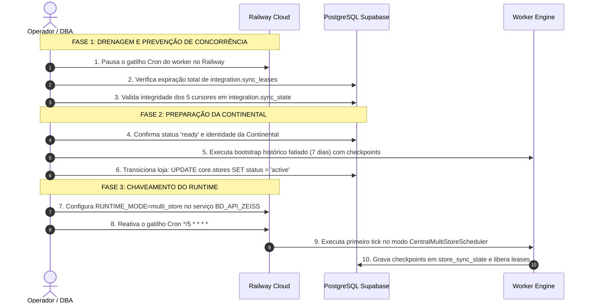

# BD_API_ZEISS — ML-006 | Ativação Controlada e Publicação da API

**Projeto:** `C:\Antigravity\BD_API_ZEISS`  
**Supabase Canônico:** `bklpztydqllqevekgins`  
**Railway:** Projeto `BD_API_ZEISS` (`6c01539c-7864-4f47-afa1-740f25086529`)  
**Data:** 19/10/2026  
**Status:** PRONTO PARA EXECUÇÃO AUTORIZADA — OPERAÇÃO CONTROLADA  
**Regra de Ouro:** BD_API_ZEISS é 100% independente de qualquer aplicação consumidora externa.

---

## 1. Sumário Executivo

A fase **ML-006** consolida o planejamento executivo final para a publicação da **Serving API independente** e a transição operacional do **Worker para o modo multi-loja**, estabelecendo barreiras rígidas para evitar execuções concorrentes, vazamento de dados entre unidades ou sobrescrita da base histórica.

> [!IMPORTANT]
> **Salvaguardas Cumpridas Integralmente nesta Fase:**
> - O serviço `BD_API_ZEISS_API` no Railway **NÃO foi criado nem publicado** nesta etapa (aguarda autorização formal).
> - A virada de runtime do worker **NÃO foi executada** (o worker no Railway permanece em modo `legacy`).
> - A loja Continental permanece em status `ready` no Supabase (`bklpztydqllqevekgins`).
> - Os 7.234 pedidos históricos permanecem com `store_id IS NULL` — **não foi declarada quarentena definitiva**, preservando-se a possibilidade de auditorias assistidas futuras.
> - Nenhuma credencial comercial foi emitida e nenhuma mutação externa foi enviada à ZEISS.

---

## Parte A — Preparação Final da Publicação da Serving API

### 1. Build e Execução de `npm run api`
- O script de inicialização do servidor HTTP (`"api": "node dist/api/server.js"`) foi testado ao vivo localmente via script de verificação integrado (`scratch/test_api_startup.js`).
- O servidor inicializou com sucesso, realizou o bind na porta dinâmica (`PORT=3099`), respondeu ao health check com HTTP 200 `{"success": true, "data": {"status": "ok", ...}}` e encerrou graciosamente sob o sinal `SIGTERM`.

### 2. Validação dos Requisitos Operacionais
- **Health Check Sanitizado:** `GET /api/v1/health` público, retornando status operacional e timestamp UTC sem expor dados internos, strings de conexão ou arquivos.
- **Autenticação Criptográfica:** Hash SHA-256 verificado em tempo constante contra `integration.api_credentials.secret_hash`. Suporte aos headers `Authorization: Bearer <token>` e `X-API-Key: <token>`.
- **Autorização Estrita:** Verificação em dois níveis: escopo da operação (`allowed_scopes`) e isolamento por loja (`allowed_store_ids`).
- **Logs Sanitizados:** Registros de acesso auditados em `integration.api_operations` sem expor payloads sensíveis ou tokens.
- **Variáveis Obrigatórias no Railway:**
  - `DATABASE_URL`: Connection string ao pooler Supabase AWS US-West-2 (`port 5432`).
  - `PORT`: Atribuída automaticamente pelo Railway no provisionamento do container.

### 3. Preparação do Serviço Railway `BD_API_ZEISS_API`
O serviço de API operará totalmente desacoplado do serviço de Worker:

| Parâmetro | Serviço Worker (`BD_API_ZEISS`) | Serviço Serving API (`BD_API_ZEISS_API`) |
|---|---|---|
| **Tipo de Serviço** | Batch Cron Job episódico | Serviço Web HTTP contínuo |
| **Gatilho / Schedule** | `cronSchedule: "*/5 * * * *"` | Escuta HTTP permanente |
| **Start Command** | `npm run worker` | `npm run api` |
| **Build Command** | `npm run build` | `npm run build` |
| **Restart Policy** | `NEVER` | `ON_FAILURE` (max 10 retries) |
| **Healthcheck Path** | `null` | `/api/v1/health` |
| **Porta de Rede** | Nenhuma (sem listener) | `$PORT` dinâmica do Railway |
| **Exposição Externa** | Nenhuma (privado) | HTTPS na borda via domínio Railway |

### 4. Segurança de Rede e Ausência de Exposição do Banco
- O banco de dados PostgreSQL do Supabase permanece sem portas abertas para a internet pública; todo acesso é intermediado pelo pooler autenticado via TLS.
- As aplicações consumidoras comunicam-se exclusivamente com a Serving API via HTTPS porta 443 na borda gerenciada pelo Railway.

### 5. Relação de Endpoints Homologados versus Implementados

```
┌─────────────────────────────────────────────────────────────────────────────┐
│                    ENDPOINTS HOMOLOGADOS NO SERVIDOR HTTP                   │
│                                                                             │
│  GET  /api/v1/health                                    [Público]           │
│  GET  /api/v1/stores/{store_id}/orders                  [orders:read]       │
│  GET  /api/v1/stores/{store_id}/orders/{order_number}   [orders:read]       │
│  GET  /api/v1/stores/{store_id}/tracking/{nf_number}    [tracking:read]     │
│  GET  /api/v1/stores/{store_id}/campaigns               [campaigns:read]    │
│  GET  /api/v1/stores/{store_id}/campaigns/{id}/leads    [leads:read]        │
│  POST /api/v1/stores/{store_id}/vouchers/activate       [vouchers:write]    │
│  GET  /api/v1/admin/unassigned-orders                   [admin:historical]  │
└─────────────────────────────────────────────────────────────────────────────┘
```

Endpoints de geração de voucher (`VCH-002`), consulta on-demand (`VCH-001`), boleto (`FIN-002`), DANFE (`FIN-003`), onboarding e bootstrap de lojas permanecem implementados nos serviços internos, mas **estritamente protegidos e não roteados no servidor HTTP** até homologação formal individual.

---

## Parte B — Plano de Virada Operacional do Worker

A virada do runtime legado para o runtime multi-loja deve seguir o plano de 10 passos executáveis, projetado para garantir zero concorrência:



### Detalhamento dos 10 Passos Operacionais:

1. **Passo 1 — Impedir Novas Execuções Legadas:** Pausar temporariamente o cron schedule `*/5 * * * *` no serviço `BD_API_ZEISS` do Railway para que nenhum tick do worker seja disparado durante a janela de transição.
2. **Passo 2 — Aguardar Término e Expiração de Leases:** Executar no Supabase:
   ```sql
   SELECT provider, domain, operation, owner_token, expires_at,
          CASE WHEN expires_at > CURRENT_TIMESTAMP THEN 'ACTIVE' ELSE 'EXPIRED' END as lease_status
   FROM integration.sync_leases;
   ```
   *Aguardar até que nenhum registro apresente status 'ACTIVE'.*
3. **Passo 3 — Confirmar Integridade dos Cursores Anteriores:**
   ```sql
   SELECT provider, domain, operation, cursor_value, last_sync 
   FROM integration.sync_state 
   ORDER BY provider, domain, operation;
   ```
   *Confirmar que os 5 cursores legados (`campaigns`, `orders`, `products`, `receivables`, `tracking`) estão preservados.*
4. **Passo 4 — Preparar a Continental para Ativação:**
   ```sql
   SELECT id, code, name, status FROM core.stores WHERE code = 'continental';
   -- Confirmar ID: 3cdde1d2-4461-475f-8faf-418bbb3790fd e status: 'ready'
   ```
5. **Passo 5 — Validar o Bootstrap e Catch-Up da Continental:**
   - Disparar o orchestrator de bootstrap para a Continental em fatias temporais de 7 dias com lookback configurado.
   - Pela regra de upsert em `PgOrdersRepository`, se qualquer pedido coincidir com a base histórica (`store_id IS NULL`), o campo `store_id` permanece nulo e os dados existentes não são modificados.
   - Os novos pedidos da Continental são inseridos com `store_id = '3cdde1d2-4461-475f-8faf-418bbb3790fd'`.
   - Checkpoints salvos atômica e incrementalmente em `integration.store_sync_state`.
6. **Passo 6 — Transição do Status da Loja:**
   ```sql
   UPDATE core.stores 
   SET status = 'active', updated_at = CURRENT_TIMESTAMP 
   WHERE id = '3cdde1d2-4461-475f-8faf-418bbb3790fd';
   ```
7. **Passo 7 — Alterar o Runtime para `multi_store`:**
   No Railway CLI:
   ```bash
   railway variables set RUNTIME_MODE=multi_store --service BD_API_ZEISS
   ```
8. **Passo 8 — Reativar o Cron Job e Confirmar o Mapa Central:**
   - Reativar o schedule `*/5 * * * *` no Railway.
   - No tick seguinte, o `CentralMultiStoreScheduler`:
     - Lê exclusivamente as políticas de `integration.sync_policies`.
     - Descobre dinamicamente a loja Continental (`status = 'active'`).
     - Adquire lease atômico em `integration.store_sync_leases`.
     - Executa a sincronização para a loja.
9. **Passo 9 — Monitorar Execução e Avanço de Cursores:**
   ```sql
   SELECT store_id, provider, domain, operation, cursor_value, last_sync 
   FROM integration.store_sync_state 
   WHERE store_id = '3cdde1d2-4461-475f-8faf-418bbb3790fd';
   
   SELECT * FROM integration.store_provider_health 
   WHERE store_id = '3cdde1d2-4461-475f-8faf-418bbb3790fd';
   ```
10. **Passo 10 — Procedimento de Rollback Imediato:**
    Se houver qualquer divergência operacional, executar a reversão para o modo legado (Seção 4).

---

## Parte C — Preservação Histórica e Segurança de Dados

### 1. Preservação dos 7.234 Pedidos sem Atribuição
- Os 7.234 pedidos com `store_id IS NULL` permanecem inalterados no banco.
- **NÃO declaração de quarentena definitiva:** Os dados permanecem sob a classificação de **Base Histórica Não Atribuída (Pendente de Conciliação Não-Automatizada)** (`UNASSIGNED_PENDING_RECONCILIATION`). Essa definição técnica preserva o registro para futuras reconciliações assistidas via documentação contábil/fiscal offline, sem fechamento de porta arbitrário.
- Nenhuma atualização em massa foi ou será disparada sobre esses registros.

### 2. Blindagem Bidirecional contra Sobrescrita (`UNIQUE (order_number)`)
O repositório `PgOrdersRepository` possui cláusulas de proteção atômicas em ambas as direções de runtime:

1. **Se o runtime multi-loja processar um pedido existente:**
   ```sql
   -- Multi-Store Branch:
   store_id = zeiss.orders.store_id,
   os_number = CASE WHEN zeiss.orders.store_id = EXCLUDED.store_id THEN EXCLUDED.os_number ELSE zeiss.orders.os_number END
   ```
   *Se o pedido possuir `store_id IS NULL` ou pertencer a outra loja, nada é modificado.*

2. **Se o runtime legado processar um pedido de loja:**
   ```sql
   -- Legacy Branch:
   os_number = CASE WHEN zeiss.orders.store_id IS NULL THEN EXCLUDED.os_number ELSE zeiss.orders.os_number END
   ```
   *Se o pedido possuir `store_id` preenchido (pertencente a uma loja), a execução legada é sumariamente impedida de sobrescrever qualquer campo.*

### 3. Blindagem contra Vazamento na Serving API
- Todas as consultas na Serving API aplicam estritamente o filtro `store_id = $1`.
- Pedidos históricos sem loja (`store_id IS NULL`) nunca são expostos em endpoints de lojas.
- O endpoint `/api/v1/admin/unassigned-orders` exige o escopo privilegiado `admin:historical:read`.

---

## Parte D — Comandos Operacionais, Testes de Aceitação e Rollback

### 1. Comandos Exatos para Publicação da Serving API no Railway
Executar via Railway CLI quando autorizado:

```bash
# 1. Criar o serviço web da API no projeto BD_API_ZEISS:
railway service create BD_API_ZEISS_API

# 2. Conectar a fonte do repositório:
railway service source connect --repo miguelbello82-png/BD_API_ZEISS --branch main --service BD_API_ZEISS_API

# 3. Configurar variáveis obrigatórias da API:
railway variables set DATABASE_URL="${{BD_API_ZEISS.DATABASE_URL}}" --service BD_API_ZEISS_API

# 4. Gerar domínio público com HTTPS automático:
railway domain --service BD_API_ZEISS_API
```

### 2. Comandos para a Virada do Worker no Railway
```bash
# 1. Configurar o modo multi-loja no serviço do Worker:
railway variables set RUNTIME_MODE=multi_store --service BD_API_ZEISS

# 2. Inspecionar logs da primeira execução do tick multi-loja:
railway logs --service BD_API_ZEISS -n 50
```

### 3. Testes de Aceitação e Critérios de Homologação

| # | Teste de Aceitação | Comando de Verificação | Critério de Sucesso |
|---|---|---|---|
| **TA-1** | **Health Check da API** | `curl -i https://<dominio-railway>/api/v1/health` | HTTP 200 `{"success": true, "data": {"status": "ok", ...}}` |
| **TA-2** | **Autenticação Incorreta** | `curl -i https://<dominio-railway>/api/v1/stores/.../orders` | HTTP 401 `UNAUTHORIZED` |
| **TA-3** | **Isolamento de Loja** | Consulta de pedidos com token autorizado da Continental | Retorna somente pedidos com `store_id` da Continental. |
| **TA-4** | **Proteção da Base Histórica** | Consulta em `zeiss.orders WHERE store_id IS NULL` | Contagem permanece estritamente em **7.234 pedidos**. |
| **TA-5** | **Tick Multi-Loja** | Consulta em `integration.store_sync_state` | Registros criados para a Continental com avanço de cursores. |
| **TA-6** | **Leases Segregados** | Consulta em `integration.store_sync_leases` | Leases de lojas não colidem com a tabela legada `sync_leases`. |

### 4. Procedimento e Critérios de Rollback de Emergência
Se for identificada qualquer inconsistência operacional:

```bash
# 1. Reverter imediatamente a variável do Worker no Railway para legacy:
railway variables set RUNTIME_MODE=legacy --service BD_API_ZEISS

# 2. Suspender a Continental no PostgreSQL:
```
```sql
UPDATE core.stores 
SET status = 'suspended', updated_at = CURRENT_TIMESTAMP 
WHERE id = '3cdde1d2-4461-475f-8faf-418bbb3790fd';
```
```bash
# 3. Limpar leases residuais da loja:
```
```sql
DELETE FROM integration.store_sync_leases 
WHERE store_id = '3cdde1d2-4461-475f-8faf-418bbb3790fd';
```
```bash
# 4. Caso a API apresente instabilidade de tráfego, pausar o serviço web no Railway:
# (Pode ser feito no painel ou desvinculando o domínio)
```

### 5. Bloqueios Reais Remanescentes (Aguardando Aprovação Formal)
Nenhum bloqueio técnico impede a ativação. As ações abaixo dependem exclusivamente de aprovação formal para execução:
1. Autorização para executar os comandos de criação do serviço `BD_API_ZEISS_API` no Railway.
2. Autorização para executar a sequência de 10 passos da virada do worker (`RUNTIME_MODE=multi_store`).
3. Autorização para transição do status da Continental para `active`.
